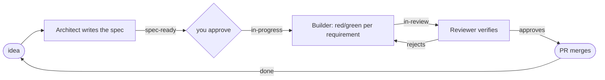

<h1 align="center"><picture><source media="(prefers-color-scheme: dark)" srcset="assets/logo-wordmark-dark.svg"></picture></h1>

Autonomous agents, safely: every change is independently reviewed before it merges.

harness-loop is a portable agent harness for spec-driven development. It runs in Claude Code, Codex, OpenCode, Antigravity and pi. Roles keep their state in repository files, so you can change the model or the CLI without losing the project's intent or history. Read [why the harness exists](docs/RATIONALE.md) for the bet in full. The exact contracts live in [docs/agents/README.md](docs/agents/README.md).

## How it works

<picture><source media="(prefers-color-scheme: dark)" srcset="assets/hero-dark.svg"></picture>

Every change is reviewed by an independent Reviewer before it merges. The default path has two gates: an Architect writes the spec, you approve it, a Builder implements it one requirement at a time, and the Reviewer verifies it. Two exceptions skip your approval: a task marked autonomous, and a `/sdd-fix` fix, which has a short brief instead of a spec and goes straight to the Builder.

A spec lists its requirements and the tests that prove them. When the project has an architecture, each spec cites the architecture decisions (ADRs) it touches. Read [CONCEPTS.md](docs/CONCEPTS.md) for the full method.

## Quick start

1. Install into your project: `./harness-install.sh --agents=host /path/to/project`
2. Check the environment from the project root: `.harness/init.sh`
3. Plan and build: run `/sdd-plan` for a new product or `/sdd-new` for a new idea, then `/sdd-next`. See [Bootstrap](docs/INSTALL.md#bootstrap-first-run).

## Commands

| Command | What it does |
|---|---|
| `/sdd-plan` | Plan a whole product: vision, architecture, ADRs and draft epics. |
| `/sdd-new` | Turn one idea into a pending task. |
| `/sdd-drill` | Split a draft epic into features. |
| `/sdd-next` | Run the next task through the loop. |
| `/sdd-fix` | Fix a small defect without a full spec. |
| `/sdd-fix-parallel` | Run a batch of safe fixes side by side. |
| `/sdd-pr-loop` | Drive the PR review cycle. Needs the Codex GitHub App; opt-in. |
| `/sdd-triage` | Triage harness defect reports. Source checkout only. |
| `/sdd-report` | Report a harness defect. |

## Supported CLIs

| CLI | How you run it |
|---|---|
| Claude Code | `/sdd-*` commands. The primary host. |
| Codex | `$sdd-*` skills from `.agents/skills`, for example `$sdd-report`. |
| OpenCode | `/sdd-*` commands and the shared `.agents/skills`. |
| Antigravity | `/sdd-*` slash commands from the shared `.agents/skills`. |
| pi | `/sdd-*` prompt templates and `/skill:sdd-*`. Trust the project first. |

Every CLI can report a harness defect: with `/sdd-report`, or `$sdd-report` in Codex. The Reviewer gate applies on every CLI.

## Documentation

| Read | For |
|---|---|
| [docs/README.md](docs/README.md) | The index of every doc. |
| [docs/CONCEPTS.md](docs/CONCEPTS.md) | The method in plain language. |
| [docs/INSTALL.md](docs/INSTALL.md) | Install, choose CLIs, upgrade. |
| [docs/WORKFLOW.md](docs/WORKFLOW.md) | How tasks move through the roles. |
| [RATIONALE.md](docs/RATIONALE.md) | Why each mechanism earns its cost. |
| [docs/BRAND.md](docs/BRAND.md) | Name, logo, palette and voice. |
| [assets/brand-sheet.png](assets/brand-sheet.png) | Every logo variant on its background. |
| [docs/agents/README.md](docs/agents/README.md) | Exact contracts for agents and tests. |

## Contributing

Run the full suite with `sh tools/run-tests.sh`. Repository layout and test conventions are in [docs/agents/README.md](docs/agents/README.md) under "Running the tests".
