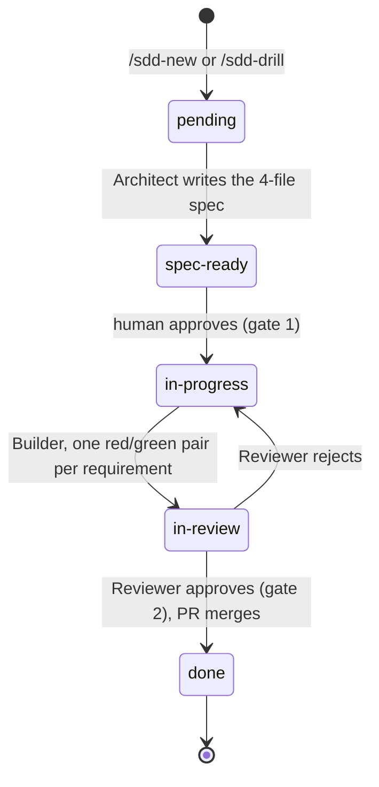
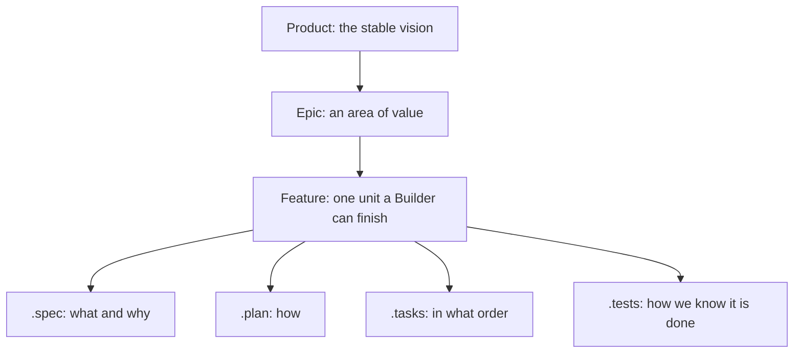

# Concepts

harness-loop is a way to let coding agents work on a repository without giving up control of it. This page explains the method in plain language. The exact contracts for agents and tests are in [agents/README.md](agents/README.md).

## The loop

Every unit of work is a task with a status. Roles move it from one status to the next, and each role starts in a clean context and reads only files.

The roles:

- **Planner** and **Driller** turn a whole project into epics, then an epic into features.
- **Inception** turns one raw idea into a `pending` task.
- **Orchestrator** picks the next task and hands it to the right role. It never writes code.
- **Architect** writes the spec for a task.
- **Builder** implements the approved spec.
- **Reviewer** verifies the result against the spec.
- **Scout** explores the code read-only when another role needs facts.

A role never sees another role's chat. It sees the spec files, the code and the tests. That is why the files must say everything.

## Specs

A spec is four short files that live next to the code. Together they say what to build, how, in what order and how to know it is done.

Requirements use the EARS pattern, so each clause maps to one test. Every plan row, task and test cites the requirement it serves, which gives a requirement-to-test trail the Reviewer can check without reading prose. When the project has an architecture, a spec also cites the architecture decisions (ADRs) it touches. [SPEC-FORMAT.md](SPEC-FORMAT.md) has the full format.

## Gates

A gate is a check that a task must pass before it moves on. The default path has two main gates and several automatic checks. Only the Reviewer gate applies to every change.

- **Gate 1, spec approval.** A human approves the spec before anything is built, unless the task is marked `autonomous`. A quick fix from `/sdd-fix` has no spec: it carries a short brief and goes straight to the Builder.
- **Gate 2, independent review.** The Reviewer, a different role in a clean context, must approve every change before its PR merges. A rejection sends the task back to the Builder.
- **Lints.** Three deterministic tools check a spec before the Builder sees it: the red/green pair shape of the tasks, the requirement or ADR citation of every plan row, and whether every file and symbol the plan names exists.
- **Environment.** `init.sh` must pass before work starts.
- **PR review.** `/sdd-pr-loop` can add an automated review of the open PR. It is opt-in.

The Reviewer never approves on a check that did not run.

## Code over prose

An instruction to an agent depends on the agent remembering it. A tool does not. The harness puts every step that must happen the same way each time into code: the task board lock, the review gates, the installer. Prompts carry only what a model cannot guess.

Prompt text is written for the models of today, so it is also tested for removal. The ablation protocol deletes a block, runs the loop and restores only what a repeated failure proves necessary. Tests and gates are never removed this way. They are the constant that makes every other change safe. [RATIONALE.md](RATIONALE.md) records which mechanisms still earn their cost, and [ABLATION.md](ABLATION.md) holds the protocol.

## Review: the elephant and the goldfish

An author with full context shares their own blind spots. The Architect is the elephant: it remembers everything about the design. The reviewers are goldfish: they start with nothing but the files, so anything the files leave out is exposed.

Two checks put this to work on a spec, before any code exists:

- **Paraphrase-back.** The Doc-critic reads the four files cold and restates what they propose and how the existing system works. Anything it cannot restate is fixed in the spec or recorded as an accepted trade-off.
- **Drift report.** On demand, `tools/drift-report.py` compares the living documents (product vision, architecture, ADRs) with the tree. It writes an advisory report that names each path or symbol the code lacks, and leaves the choice between fixing the doc or the code to a human.

The Reviewer applies the same idea to the code: it reads the spec and the diff cold and tries to break the tests before it approves.

## Further reading

- [WORKFLOW.md](WORKFLOW.md) — how tasks move through the roles, the gates and the PR loop.
- [SPEC-FORMAT.md](SPEC-FORMAT.md) — the spec hierarchy, EARS and the four files.
- [RATIONALE.md](RATIONALE.md) — why the harness exists and what each mechanism protects.
- [ABLATION.md](ABLATION.md) — how prompt text is removed safely.
- [agents/README.md](agents/README.md) — exact contracts, moved verbatim from the human docs.
