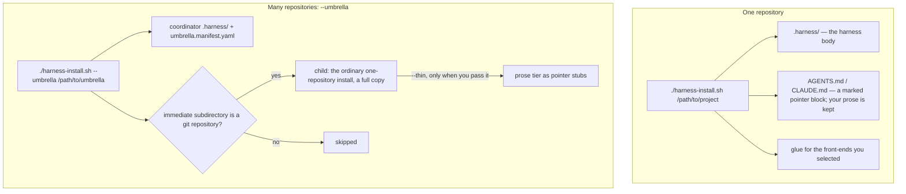
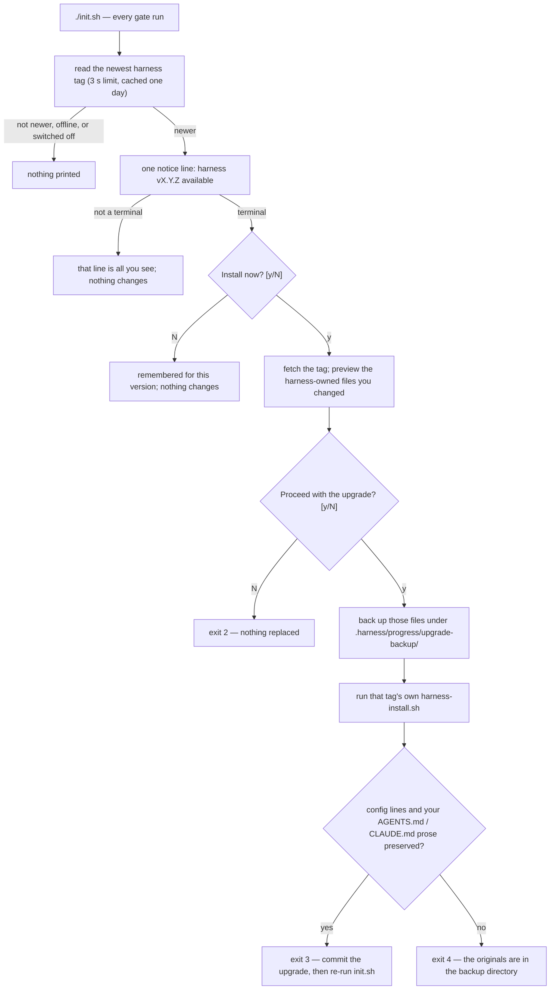

# Installing the harness

The harness installs into any repository as a self-contained `.harness/` directory plus a few
thin pointer files. Install and upgrade are the same command, and you can run it again at any
time. It supports five front-ends, in priority order: Claude Code, Codex, OpenCode,
Antigravity and pi.

Exact contracts — exit codes, flags, edge cases — are in [agents/INSTALL.md](agents/INSTALL.md).

## Prerequisites

- A Unix shell.
- `python3` with the standard `fcntl` module. `init.sh` fails without it. No third-party
  Python packages are needed.
- Node is optional for picking the next task (there is a prose fallback). Board mirrors need it.
- `gh`, `jq` and the Codex GitHub App are needed only if you turn the PR loop on.

## Install

From a checkout of the harness:

```bash
./harness-install.sh /path/to/your-project
```

An interactive install asks up to three questions: which front-ends, which builder backend, and
whether to enable the PR loop. The second and third keep the current value when you press Enter,
and each has a flag for scripted installs: `--agents=`, `--builder-backend=` and `--pr-loop=`.

What lands in your project:

- The harness body under `.harness/`. The files that are yours inside it (config, specs, task
  state, progress) are seeded once and kept on upgrade (see Upgrade for the exceptions).
- A marked pointer block in `AGENTS.md`, and in `CLAUDE.md` when Claude is selected. Anything
  you wrote outside the block is kept.
- Commands and role files only for the front-ends you selected.

The zero-dependency telemetry reporter ships in `.harness/tools/`; see
[Observability](agents/README.md#observability-telemetry).



## Choose your front-ends

The keys are `claude`, `codex`, `opencode`, `antigravity` and `pi`.

- `--agents=claude,codex` (or `HARNESS_AGENTS`) selects exactly those.
- `--agents=all` selects all five.
- `--agents=host` selects the CLI that is running the installer. It must be the whole value.
- `--print-agents` shows what the installer detected and what the picker would start from,
  and writes nothing.

An unattended install on a fresh project selects Claude only. An upgrade keeps the selection
recorded in `.harness/.agents`. To add or remove a front-end, run the installer again with the
selection you want.

How hosts are detected, and the retired-host rules, are in
[the host-detection contract](agents/INSTALL.md#host-detection----agentshost-opt-in).

## Bootstrap (first run)

**New product.** A single-repository install never runs `git init` for you: `cd` into the project first, then
`git init` and commit. The target can be an empty directory. Then:

1. Fill in the `TODO`s in `.harness/specs/product.md`.
2. Run `/sdd-plan` to write the vision, architecture and decisions and seed draft epics.
3. Run `/sdd-drill <epic-id>` to split the first epic into features.
4. Commit the planning baseline, then create the first feature branch.
5. Run `/sdd-next` and keep running it.

**Existing project.** Run `/sdd-next`. It sends the seeded bootstrap task to the Architect, who
detects your test, lint and typecheck commands, then stops at the human gate for your approval.
Later work enters with `/sdd-new "<idea>"`.

## Upgrade

By hand: `cd` into the harness checkout, run `git pull`, then run
`./harness-install.sh --agents=<your selection> /path/to/your-project` again. The harness body
and the glue for selected front-ends are refreshed, and the pointer block is replaced in place.

Your `harness.config.yaml` (new default keys are appended), `product.md`, `tasks.json`, epic specs
and progress are kept; the one exception is a `product.md` you never edited, which is refreshed to
the new stub.

The harness also tells you when a newer version exists. `init.sh` reads the newest version tag of
the harness remote, and when it is newer than yours it prints one line:

```text
🔔 harness v0.110.0 available (installed v0.109.0)
```

Away from a terminal the check prints that one line and changes nothing: the gate's exit code is
the same as without it. At a terminal it also asks `Install now? [y/N]`. Anything but `y` or `Y` is
remembered for that version, so the line keeps printing and the question stops until a newer
version appears. The remote is read with a short time limit and, by default, at most once a day. Any
failure prints nothing.

Nothing in your project is replaced until you answer `y` twice — once to fetch and preview, once
to proceed. The preview lists the harness-owned files you changed or added, which the upgrade
will replace. On the second `y` those files are backed up, the new version's own installer runs, and
the result is checked rather than assumed: every line of your `harness.config.yaml` must still be
there in order, and everything in `CLAUDE.md` / `AGENTS.md` outside the pointer block must be
unchanged.



The exit codes of that path: `2` you declined at the preview, `3` upgraded, `4` upgraded but a
protected file did not survive, `5` the fetch or the installer failed. The upgrade never commits
or stages anything.

Switches for the update check:

| To | Do this |
|---|---|
| Turn it off for good | `update.check: false` in `harness.config.yaml` |
| Turn it off for one run | `HARNESS_SKIP_UPDATE_CHECK=1 ./init.sh` |
| Check a fork | `update.remote: <git URL>` in `harness.config.yaml` |

Commit the upgrade: `init.sh` fails until the upgrade is committed. On a project that is not a git work tree it skips the
check; when nothing under `.harness/` is tracked it warns and goes on. To proceed once anyway,
run `HARNESS_SKIP_DRIFT_CHECK=1 ./init.sh`.

## Umbrella (many repositories)

For a product that spans several repositories, one command installs the harness across the
directory that holds them:

```bash
./harness-install.sh --umbrella /path/to/umbrella-dir
```

The umbrella directory gets a coordinator `.harness/` and an `umbrella.manifest.yaml` with one
entry per child. Children are the umbrella's immediate subdirectories that are git repositories;
each gets the ordinary single-repository install as a full copy, and `--thin` converts a child to
pointer stubs only when you pass it. Hidden directories are skipped, and so is any child whose
name is not lowercase letters, digits and hyphens (with a warning). Running it again picks up new
children and leaves existing manifest entries alone.

- `--shared-repo` makes the umbrella root a git repository for the shared specs and task state.
  It runs `git init` at the root only when there is no `.git` yet.
- `--from-manifest <file>` turns an existing single install into the coordinator, using the
  draft manifest that `/sdd-plan` wrote. It creates missing child directories and runs
  `git init` in them.

The rest is in [UMBRELLA.md](UMBRELLA.md).

## Ownership

| Whose | Files | On upgrade |
|---|---|---|
| The harness's | `.harness/{AGENTS.md,agents,docs,store,tools,specs/_templates,init.sh}` and the generated front-end glue | Refreshed. Claude role and command files are always rewritten, so edits there are lost. Edited Codex roles, Codex and pi units and `opencode.json` are kept with a warning. |
| Yours | `.harness/{harness.config.yaml,init.project.sh,specs/product.md,specs/glossary.md,specs/epics,state/tasks.json,progress}` | Kept. The config gains any new default keys. |
| Local only | `.harness/{telemetry.jsonl,workers.json}` | Ignored by git. |

## Further reading

- [Pi](agents/INSTALL.md#pi) — the pi front-end, trust and preflight
- [Retiring Gemini](agents/INSTALL.md#retiring-gemini) — upgrading an install that used it
- [Host detection](agents/INSTALL.md#host-detection----agentshost-opt-in) — markers and overrides
- [The PR loop](agents/INSTALL.md#sdd-pr-loop-opt-in-gated-on-pr_loopenabled) — what it needs
- [Harness feedback](agents/INSTALL.md#harness-feedback-feedback--on-by-default) — the reporting block
- [Worker roster](agents/INSTALL.md#worker-roster-workersroster--opt-in-local-only) — local worker list
- [Model routing](agents/INSTALL.md#per-role-model-routing-models--opt-in) — a model per role
- [Self mode](agents/INSTALL.md#self-mode----self-harness-developers-only) — for harness developers
- [Config migration](agents/INSTALL.md#config-migration-on-upgrade-non-destructive) — new keys on upgrade
- [Layout and ownership](agents/INSTALL.md#layout--ownership) — the full table
- [UMBRELLA.md](UMBRELLA.md), [CONFIG-LAYERING.md](CONFIG-LAYERING.md), [WORKFLOW.md](WORKFLOW.md)
