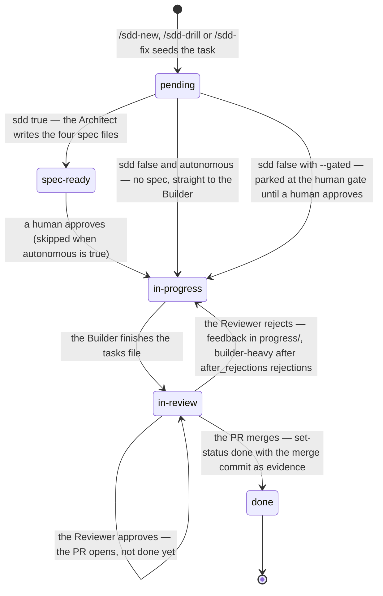
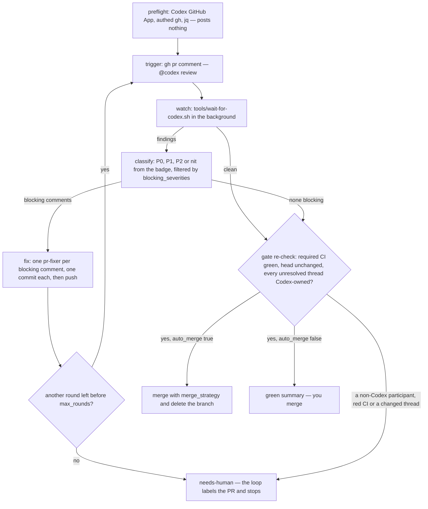

# How work moves through the harness

A task is a row on the board. The Orchestrator reads its status and hands it to one role at a
time: the Architect writes the spec, the Builder writes the code, the Reviewer checks it. Two
gates frame the story, a human approval before code is written and an independent review before
anything merges, and each has exceptions that this page names.

Exact contracts — the routing table, every reason code, every exit code — are in [agents/WORKFLOW.md](agents/WORKFLOW.md).

## From idea to task

For a new product, `/sdd-plan` writes the vision, the architecture, the decision records and a
set of `draft` epics. `/sdd-drill <epic-id>` then turns one epic into features; it is the step
that moves an epic from `draft` to `planned`, and it decomposes the epic without writing any
feature spec. Epics have their own short lifecycle: `draft`, `planned`, `in-progress`, `done`.

`autonomous: true` skips the approval gate, not the planning gate: a feature in a `draft` epic is never selected, whatever the feature itself says.

For later work in an existing project, `/sdd-new "<idea>"` asks a few questions and seeds a
`pending` row plus a short intent brief. It seeds; it never writes the spec. For a small fix,
`/sdd-fix "<description>"` seeds a fix under the maintenance epic with a brief and no spec at
all. The next section says what happens to each kind of row.

## The feature state machine

Every feature has one status, and the Orchestrator routes on it. The diagram shows the whole
path, including the human approval, its autonomous skip, the rejection loop and the single
route to `done`.

- **`pending`** — the task is seeded and not yet specced. With `sdd: true` (the full flow) the
  Architect writes the four spec files and the feature becomes `spec-ready`.
- **`spec-ready`** — the spec waits at the human gate, described next.
- **`in-progress`** — the Builder works through the tasks file as red and green pairs: a
  failing test first, then the minimal code that passes it.
- **`in-review`** — the Reviewer verifies every requirement. Approval opens the PR and the
  feature stays here.
- **`done`** — written after the work lands.

`done` is written after the work lands — the PR merge, or `none:<why>` when there is nothing to merge — never on the approval; an approved feature stays `in-review` while its PR is open.

A feature with `sdd: false` skips the spec, because a one-line tweak does not need four files.
A fix with `sdd: false` has no spec: when it is autonomous the Orchestrator sets it `in-progress` and the Builder starts at once; `/sdd-fix --gated` parks it at the human gate until a human moves it to `in-progress` or re-stamps it autonomous.

## The human gate

With `require_spec_approval: true` (the default) the Orchestrator pauses at `spec-ready` until a human moves the feature to `in-progress`; a task marked `autonomous: true` skips the pause — use it only for low-risk work.

At the gate a human does one of two things. Reading the four spec files and asking for changes
leaves the feature at `spec-ready` while the Architect revises. Moving the feature to
`in-progress` authorizes coding.

The gate exists so that you own what is being built before hours of code go into a wrong
premise. An autonomous task and an autonomous fix run without the pause, so the gate is a default you
can turn off per task, not a rule that holds for every row.

## Build and review

The Builder commits after each green test, so the history shows the work a pair at a time. The
Reviewer runs the gate and the tests, checks every requirement against the spec and exercises
the behaviour. Approval opens the PR; the merge, not the approval, ends the feature.

A rejection returns the feature to `in-progress` with written feedback under `progress/`, and the build and review loop repeats until green.

Two Builder roles exist. `builder-heavy` is the same instructions at a heavier model tier; it takes over after `escalation.after_rejections` rejections (the shipped value is `2`), or from round one when the spec is tagged `complexity: complex`.

Both routes need a second yes from the installer's arming verdict, and `after_rejections: 0` turns escalation off entirely, `complexity: complex` included.

The choice is made by a tool, `tools/builder-role.sh`, not by judgement, so the same board state
always yields the same answer. The check looks at whether the stamp differs, not whether it is
stronger; ranking models is up to you.

## The PR review loop

`/sdd-pr-loop` is installed only while `pr_loop.enabled` is `true`, and a fresh install seeds `false`; without it, request the review, apply the blocking findings and wait for the merge yourself.

Once a feature's local gate is green and its PR is open, `/sdd-pr-loop <pr>` drives the Codex
review cycle to a terminal state. It needs the Codex GitHub App on the repository, an
authenticated `gh` and `jq`; a preflight checks all three and posts nothing.

A round in five lines: run the preflight, post the trigger comment, watch for the answer in the
background, classify each fresh finding by its severity badge against `blocking_severities`, and
start one `pr-fixer` per blocking comment. Then the gate is checked again.

The loop merges only when every gate is green and every unresolved review thread is Codex-owned; a thread with a non-Codex participant routes the PR to `needs-human`, and so does reaching `max_rounds`.

With `auto_merge: false` the loop stops after the green summary and leaves the merge to you.

On either terminal state the loop posts a handover summary on the PR.

## When work stops

When `/sdd-next` finds nothing to run, it names each blocked candidate with a reason code and
ends with `no actionable work`. The codes include `unmet-dependency`, `dependency-cycle`,
`gated-epic`, `human-gate`, `parked`, `gated-owner`, `owner-excluded` and `no-candidates`.

A park is a field on a feature, not a status. It carries a required `reason`, it composes with
every status except `done`, and `/sdd-next` skips the feature until someone removes the park.
An approved feature whose PR is still open is parked with `gate: merge` and reported as
`awaiting-merge`; the park clears when the merge is recorded. An owner gate means a person has
to act, not an agent, and no retry will clear it. On a PR, `needs-human` means the loop stopped
and a person finishes the review.

## Further reading

Each link opens the section of the exact contract that decides the topic.

- [Intake](agents/WORKFLOW.md#intake--the-step-before-pending-sdd-new) — how an idea becomes a `pending` row.
- [Epic lifecycle](agents/WORKFLOW.md#epic-lifecycle) — `draft` to `done`, and the planning gate.
- [State machine](agents/WORKFLOW.md#state-machine) — every transition and its guard.
- [The human gate](agents/WORKFLOW.md#the-human-in-the-loop-gate) — what the approval pause covers.
- [Selective SDD](agents/WORKFLOW.md#selective-sdd-the-sdd-flag) — the `sdd` flag and the fix lanes.
- [Which Builder runs](agents/WORKFLOW.md#which-builder-runs--deterministic-escalation) — the escalation rule.
- [The PR review loop](agents/WORKFLOW.md#the-pr-review-loop-sdd-pr-loop) — every step and exit code.
- [Parking a feature](agents/WORKFLOW.md#parking-a-feature-parked) — parks, owner gates and landing evidence.
- [Diagnosing blocked selection](agents/WORKFLOW.md#diagnosing-blocked-selection) — the reason codes in full.
- [Running in waves](agents/WORKFLOW.md#running-in-waves-and-across-machines) — parallel work and several machines.
- [The spec format](SPEC-FORMAT.md) — the four files every `sdd: true` feature carries.
- [Concepts](CONCEPTS.md) — the whole harness in one page.
- [Installing](INSTALL.md) — setup, upgrade and configuration.
