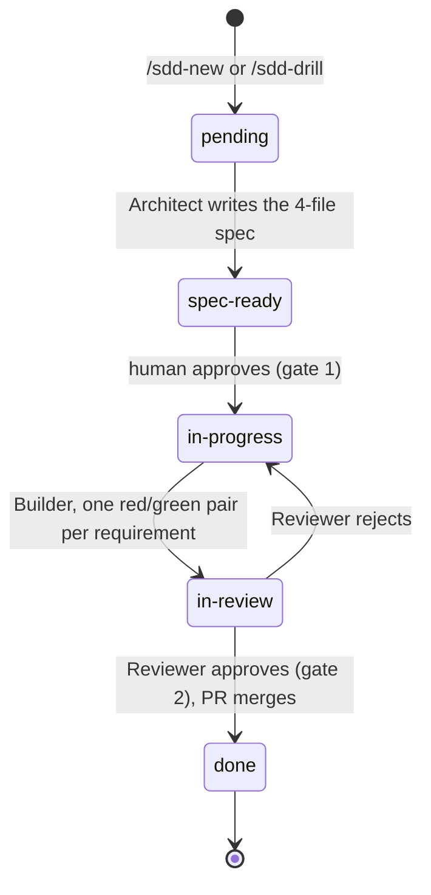
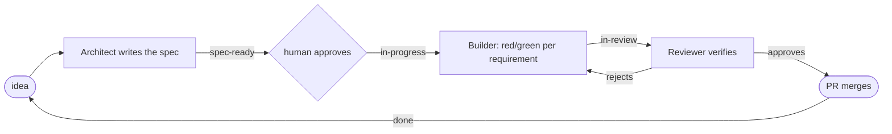

# Docs for humans, slice 1 — Technical Plan

> Translates the .spec.md intent into design. Every table row cites the `R-id`(s) it serves
> or the `ADR-NNNN` that defers it (ADR-0009) — this plan must exit `0` under
> `tools/plan-cite-check.py` and the feature directory under `tools/readiness-check.py`
> (every first cell below exists today or has `create` as the first word of its Change cell).
> The Builder reads `progress/lessons.md` first. Exact prose the Builder pastes is in
> *Approach notes → Exact text*, inside fenced blocks (fenced text is invisible to the
> readiness lint). Paths that do not exist in this repository are written `<repo>/…` or inside
> fences.

## Stack & dependencies

- Language/framework: Markdown + Mermaid (GitHub-rendered); POSIX `sh` + `git` + `awk` for
  `tools/docs-move-check.sh` and the suite (run under dash by `tools/run-tests.sh`); Python 3
  **stdlib only** (`os`, `sys`, `re`, `glob`) for `tools/doc-cite-check.py`, like
  `tools/readiness-check.py`. PNG dimensions are read with `python3 -c` + `struct` (IHDR at
  bytes 16–24); SVG well-formedness with `xml.etree.ElementTree`.
- New dependencies: **none**. No mermaid-cli, no image library.
- Inputs the Builder does not produce: `assets/logo.svg` (present), `assets/logo-wordmark.svg`,
  `assets/social-preview.png`, optional `assets/hero.*` — placed by the Orchestrator (Recraft)
  before T11b. If absent at T11b, stop and report; do not draw them.
- Repo root for every command: the `feat/E39-F01-docs-for-humans` worktree. Board writes carry
  `HARNESS_DIR=<worktree>` (lesson: tasks-lock remaps linked worktrees); the Builder never writes
  the board.
- **Test-runner slot.** One `run-tests.sh` at a time on this machine, `--jobs ≤ 4`. While
  iterating run only the suites you touched, one at a time: `sh tests/test_docs_for_humans.sh`,
  then each re-pointed suite in the coupling table, then `sh tests/test_install.sh`,
  `sh tests/test_rationale_docs.sh`, `sh tests/test_suite_hygiene.sh`, `sh tests/test_self_drift.sh`.
  The full `sh tools/run-tests.sh` once, serially, before hand-off; never relaunch a killed run.
  `TMPDIR` for the suites: a path with no ancestor relationship to the repo
  (`/var/tmp/E39-F01-builder/`, created first).

## Data model  (serves: R1, R3, R4, R6, R7, R8, R9, R11)

No stored state. The data model is the set of file contracts the suite and the two tools read.

| Entity | Form (byte-exact where quoted) | Where the grammar is silent | R-id |
|---|---|---|---|
| machine counterpart | `docs/agents/<NAME>.md` for `docs/<NAME>.md`; `docs/agents/README.md` for the repository `README.md` | basename preserved including case; `docs/agents/README.md` is both index and README counterpart | R1, R9 |
| announcement | line 1 `# harness-loop docs for agents`; first non-empty line after it `> For agents — exact contracts; humans start at docs/.` | nothing between them but blank lines | R1 |
| index row | `| <human doc path> | <machine counterpart path> | <what moved, free text> |` under `## Index`; header row `| Human doc | Machine counterpart | What moved |` | paths are repo-rooted in code spans; the README row reads `| \`README.md\` | \`docs/agents/README.md\` | … |` | R1, R9 |
| registry entry | in `tests/test_docs_for_humans.sh`: `HUMAN_DOCS="README.md:150:yes docs/README.md:60:no docs/CONCEPTS.md:220:yes docs/BRAND.md:90:no"` — space-separated `<path>:<budget>:<yes\|no>` | a later slice appends an entry; an override above 300 carries a `# why:` comment on the line above | R6 |
| moved section | heading line byte-identical to the base README; body lines byte-identical after normalisation `N(line)` = collapse runs of whitespace to one space, trim, replace every `](…)` with `]()` | sections appear in base order after `## Conventions` | R4, R8 |
| backtick token | the content of a `` `…` `` span (single backticks, not inside fenced code, no newline inside) | compared as exact strings after trimming; a span empty after trimming is ignored | R8 |
| citation | regex (one line at a time, fenced code skipped): `(?:\.harness/)?docs/(?:[A-Z0-9][A-Z0-9.-]*\.md\|agents/[A-Za-z0-9._-]+\.md\|history/[A-Za-z0-9._-]+\.md)` + optional `#([A-Za-z0-9._-]+)`; else, on the rest of the same line within 4 chars: `→ "T"`, `→ \*T\*`, `-> "T"`, `§ T` (T runs to the closing quote/star, or for `§` to the first of `.`, `,`, `;`, `)`, `` ` `` or end of line) | a lowercase `docs/x.md` is not a citation (external); a path inside a fenced block is skipped; markdown link targets are matched by the same regex | R7 |
| heading match | slug: GitHub rule — lowercase, drop every char not `[a-z0-9 _-]`, spaces → `-` (so `## Staying current — the update check (E38-F01)` → `staying-current--the-update-check-e38-f01`); title: lowercase, backticks/stars removed, whitespace collapsed; the cited title must be a **prefix** of some heading's normalised text in the cited file | headings are `^#{1,6} ` lines outside fenced code | R7 |
| finding | `CITE <file>:<line> <citation> — no such file` / `— no heading matches #<slug>` / `— no heading matches "<title>"` | file paths relative to root; sorted by file then line | R7 |
| move report | `VANISHED-TOKEN \| <doc> \| <token>`; `DROPPED-LINE \| <doc>:<base-line> \| <text>`; summary `docs-move-check: <V> vanished tokens, <D> dropped lines, <M> moved lines, <F> human docs examined (base <short-sha>)` | `<M>` counts removed backtick-bearing lines whose `N(line)` was found under `docs/agents/**` or `docs/history/**`; `<F>` counts human docs with any diff | R8 |
| brand sites | `README.md` line 1 the centered `<h1>` wordmark whose `` alt is `harness-loop`; `docs/BRAND.md` `**Name.** harness-loop`; `assets/logo-wordmark.svg` text; tagline authored as `**Tagline.** <text>` in BRAND and copied as `<p align="center"><text></p>` on its own line in README (lines 2–8) | no other doc needs the token; `.harness/`, `harness-install.sh`, `harness.config.yaml`, `/sdd-*` unchanged | R3, R11 |
| social preview | PNG, IHDR width 1280, height 640 (`struct.unpack('>II', data[16:24])`) | the human uploads it in GitHub settings; the file is the source | R11 |

## API / interface  (serves: R2, R6, R7, R8, R10, R12)

| Interface | Shape | R-id |
|---|---|---|
| `tools/doc-cite-check.py [--root <dir>] [<file>…]` | no files ⇒ the default citing set `AGENTS.md CLAUDE.md README.md agents/*.md docs/**/*.md harness-install.sh init.sh tools/*` (existing ones only); stdout: `CITE …` lines then the summary; exit 0 / 1 / 2 (`--root` not a directory, unknown flag, a named file missing ⇒ `doc-cite-check: error: <what>` on stderr); `-h`/`--help` prints usage, exit 0 | R7, R10 |
| `tools/docs-move-check.sh <base-ref> [<head-ref>]` | base = `git merge-base <base-ref> <head>`; head omitted ⇒ working tree (tracked + untracked non-ignored, like `tools/test-drift-check.sh`); stdout: finding lines then exactly one summary; exit 0 (V=0) / 1 (V>0) / 2 (usage: missing base-ref, unknown flag) / 3 (not a git repo, ref does not resolve, no merge base — reason on stderr); `LC_ALL=C` | R8 |
| `tests/test_docs_for_humans.sh` | POSIX sh, `set -eu`, `trap … EXIT` + `trap 'exit 1' HUP INT TERM`, `fail`/`pass`, rows `R1_…`–`R12_…` dispatched from one flat list; fence-aware slicing via `tests/lib/fence.awk`; builds a temp git repo under `$T` for the R8 rows; never reads `VERSION` as a literal, never diffs a DO-NOT-TOUCH file against `main` | R1–R11 |
| `tests/test_install.sh` additions | `test_docs_for_humans_installed_contract()`: for `docs/agents/README.md docs/README.md docs/CONCEPTS.md docs/BRAND.md`: `cmp -s "$SRC/$f" "$T/.harness/$f"`; `! find "$T/.harness" -name assets \| grep -q .`; for `tools/doc-cite-check.py tools/docs-move-check.sh`: `[ -x "$T/.harness/$f" ]`, `[ -x "$SRC/$f" ]`, `cmp -s`, and `grep -qF 'chmod +x "$H/'"$f"'"' "$SRC/harness-install.sh"`; `grep -qF '| \`docs/agents/README.md\` |' "$T/.harness/AGENTS.md"`; registered directly after `test_drift_report_installed_contract` in the runner list | R2, R10, R12 |
| `harness-install.sh` | two lines after the last existing `chmod +x "$H/tools/…"` line: `chmod +x "$H/tools/doc-cite-check.py" 2>/dev/null \|\| true   # E39-F01 doc-citation lint` and `chmod +x "$H/tools/docs-move-check.sh" 2>/dev/null \|\| true   # E39-F01 pre-PR verbatim-move check`; no emitter touched; `sh harness-install.sh --self` must produce no diff | R12 |
| `AGENTS.md` reference table | two rows appended after `| \`docs/SPEC-FORMAT.md\` | … |`: text D | R10 |
| `VERSION` / `CHANGELOG.md` | `0.109.0` → `0.110.0` unless `main` moved (`git show origin/main:VERSION` before the final rebase); `## [0.110.0] — <date>` with `### Added — docs for humans, slice 1 (E39-F01)`: text E | R12 |

**Decision — a mirror per doc, not per topic (D1).** Tests slice by heading and assume
adjacency; a per-doc mirror keeps C3 a path substitution and gives F02–F05 disjoint files.
**Decision — the move proof is a pre-PR tool, not a permanent diff.** A permanent suite must not
diff against `main` (lesson: permanent-suite anti-pattern); `docs-move-check.sh` runs at the
Reviewer → PR handoff like `test-drift-check.sh`, and the permanent suite pins what is stable
(headings, announcement, registry rules) plus fixture rows for the tool itself.
**Decision — tokens, not sentences, are the vanish test.** A rewrite legitimately drops prose;
what must never vanish is a backticked contract token (a flag, an env var, a path, an exit
code). `DROPPED-LINE` is informational because a reworded sentence that still names `init.sh`
is fine; `VANISHED-TOKEN` fails because a token gone from the whole doc set is a lost contract
by definition — if it was deprecated, it still moves (to `docs/agents/` or `docs/history/`).
**Decision — citation lint matches a title prefix.** Citations omit heading suffixes
(`§ Per-role model routing` for `## Per-role model routing (\`models:\`) — opt-in`); exact match
would flag every one of them; a prefix match is what the readers actually do.
**Decision — brand is a three-site token (D6).** The suite compares README's heading alt text and tagline to
`docs/BRAND.md`, so a rename cannot half-land.

## Files to change  (serves: R1–R12)

| File | Change | R-id |
|---|---|---|
| `docs/agents/README.md` | **create** — H1 + announcement (text A), `## Index` (one row: README), `## Conventions` (text B, C1–C8), then a heading `## Moved from the README (0.109)` holding the heading-less baseline/Gemini paragraph, then the moved README sections in base order with heading lines byte-identical and bodies byte-identical except relative link targets retargeted so they resolve from `docs/agents/`: every repo-root-relative target gets `../../` (`agents/builder.md#…` → `../../agents/builder.md#…`, `store/board-mirror.md` → `../../store/board-mirror.md`), `docs/<NAME>.md` → `../<NAME>.md`, `./docs/` → `../`, in-page `#anchor` kept | R1, R4, R9 |
| `docs/README.md` | **create** — the human index, ≤60 lines: an opening line `Agents: start at [agents/README.md](agents/README.md)` (within the first 15 lines — R9's counterpart rule applies to this file too), then one line per human doc (`CONCEPTS`, `INSTALL`, `WORKFLOW`, `UMBRELLA`, `SPEC-FORMAT`, `CONFIG-LAYERING`, `RATIONALE`, `ABLATION`, `HARNESS`, `BRAND`, `BASELINE-0.78.1`) with a one-sentence purpose, ; no diagram | R1, R9 |
| `docs/CONCEPTS.md` | **create** — ≤220 lines; sections per R5; `## The loop` opens with the `stateDiagram-v2` (text C skeleton; the Builder may add `parked`/`awaiting-merge` as side states); `## Review: the elephant and the goldfish` names paraphrase-back (`tools/`-free prose: "the Doc-critic reads the four files cold and paraphrases them back") and the drift report; links per R5; first 15 lines link `agents/README.md` | R5, R9 |
| `docs/BRAND.md` | **create** — ≤90 lines; text F skeleton; asset paths in code spans only (no image embeds — C7) | R11 |
| `README.md` | **rewrite** — ≤150 lines: line 1 `<h1 align="center"><picture><source media="(prefers-color-scheme: dark)" srcset="assets/logo-wordmark-dark.svg"></picture></h1>`; the centered tagline line `<p align="center"><tagline></p>`; one paragraph *what it is* ending with the counterpart link (`…the exact contracts live in [docs/agents/README.md](docs/agents/README.md)`, within the first 15 lines — C6); `## How it works` with the centered `assets/hero.svg` (width 720) above the loop-with-gates `flowchart` (text G skeleton, statuses as solid-edge labels) and ≤2 short paragraphs (specs cite the ADRs they touch); `## Quick start` with 3 numbered steps (install with `./harness-install.sh --agents=host /path/to/project`, `./init.sh`, `/sdd-plan` or `/sdd-new` then `/sdd-next`; link `docs/INSTALL.md#bootstrap-first-run`); `## Commands` one-line table for the nine `/sdd-*` commands — `/sdd-plan`, `/sdd-new`, `/sdd-drill`, `/sdd-next`, `/sdd-fix`, `/sdd-fix-parallel`, `/sdd-pr-loop`, `/sdd-triage`, `/sdd-report` (the `/sdd-pr-loop` line says *opt-in; needs the Codex GitHub App*; the `/sdd-triage` line says *source checkout only*); `## Supported CLIs` short table (Claude Code `/sdd-*`; Codex `$sdd-*` skills in `.agents/skills`, e.g. `$sdd-report`; OpenCode; Antigravity; pi); `## Documentation` links per R3 plus `[why the harness exists](docs/RATIONALE.md)` in the intro and `[RATIONALE.md](docs/RATIONALE.md)` in the table; `## Contributing` (3 lines: `sh tools/run-tests.sh`, link `docs/agents/README.md` → *Running the tests*). Everything else moves (R4) | R3, R4 |
| `tools/doc-cite-check.py` | **create** — executable, `#!/usr/bin/env python3`, docstring stating usage, the citation grammar, the slug/prefix rules, exit codes and *Known limits* (title cited across a line break is not seen; a citation inside a fenced block is skipped by design; lowercase `docs/x.md` is external by convention). Functions: `iter_unfenced(lines)`, `citations(line)`, `headings(path)`, `slug(text)`, `norm_title(text)`, `check(root, files)`, `main(argv)` | R7, R10 |
| `tools/docs-move-check.sh` | **create** — executable, header comment in the shape of `tools/test-drift-check.sh` (usage, output grammar, exit codes, known limits: a token split across lines is not a span; fenced code is skipped on both sides; renamed human docs read as removed + added). `LC_ALL=C`; `git merge-base`; `git show <base>:<doc>` vs head file; awk for span extraction, `N()` normalisation and lookup | R8 |
| `tests/test_docs_for_humans.sh` | **create** — the feature suite (see `E39-F01.tests.md`): registry, style rows, scaffold rows, brand rows, fixture rows for both tools (temp git repo for R8), repo rows (`doc-cite-check` exit 0, links resolve) | R1, R3–R11 |
| `tests/fixtures/doc-cite/` | **create** — `README.md` (every planted defect with file and line, the `<repo>/` convention) and `repo/`: `<repo>/docs/GOOD.md` (headings incl. `## Staying current — the update check (E38-F01)` and `## Per-role model routing (\`models:\`) — opt-in`), `<repo>/docs/agents/GOOD.md`, `<repo>/agents/role.md` citing: `docs/GOOD.md#staying-current--the-update-check-e38-f01` (ok), `docs/GOOD.md § Per-role model routing` (ok, prefix), `` `.harness/docs/GOOD.md` → "Staying current" `` (ok), `docs/security.md#project-trust` (ignored, lowercase), a fenced block citing `docs/NOPE.md` (ignored), `docs/MISSING.md` (finding: no such file), `docs/GOOD.md#no-such-slug` (finding), `docs/GOOD.md -> "Retired section"` (finding), `docs/agents/GOOD.md` (ok) | R7 |
| `tests/test_install.sh` | **add** `test_docs_for_humans_installed_contract` (shape in *API*) and register it after `test_drift_report_installed_contract`; **modify** the E23 R10 doc loop `for _doc in "$SRC/README.md" "$SRC/docs/HARNESS.md" "$SRC/docs/INSTALL.md"` → `"$SRC/docs/agents/README.md"` in place of `"$SRC/README.md"` (C3) | R2, R4, R10, R12 |
| `tests/test_doc_critic.sh` | **modify** (C3) — `README="$SRC/README.md"` → `README="$SRC/docs/agents/README.md"` (the variable is used only by `test_readme_paraphrase_sentence`; verify with `grep -n '\$README' tests/test_doc_critic.sh` first — if another row reads it, re-point only inside that function) | R4 |
| `tests/test_readiness_check.sh` | **modify** (C3) — `span "$ROOT/README.md" '## How it works' '## Quick start'` → `"$ROOT/docs/agents/README.md"` | R4 |
| `tests/test_drift_report.sh` | **modify** (C3) — `_rd="$ROOT/README.md"` in `R9_readme_sentence` → `"$ROOT/docs/agents/README.md"` | R4 |
| `tests/test_dependency_diagnostics.sh` | **modify** (C3) — `for doc in "$ROOT/docs/WORKFLOW.md" "$ROOT/README.md"` → `"$ROOT/docs/agents/README.md"` | R4 |
| `tests/test_feedback_triage.sh` | **modify** (C3) — python list `['README.md','docs/WORKFLOW.md']` → `['docs/agents/README.md','docs/WORKFLOW.md']` | R4 |
| `tests/test_pi_agents.sh` | **modify** (C3) — both five-docs loops `for _d in README.md AGENTS.md docs/HARNESS.md …` → `docs/agents/README.md AGENTS.md …` | R4 |
| `tests/test_pi_front.sh` | **modify** (C3) — the five-docs loop, same substitution | R4 |
| `tests/test_escalation.sh` | **modify** (C3) — `_rd="$(tr '\n' ' ' < "$SRC/README.md" \| tr -s ' ')"` → `"$SRC/docs/agents/README.md"` | R4 |
| `AGENTS.md` | **add** two reference-table rows (text D) | R10 |
| `harness-install.sh` | **add** the two chmod lines (shape in *API*) | R12 |
| `VERSION` | **bump** to the next MINOR over the then-current `main` value (`0.109.0` today ⇒ `0.110.0`). Before bumping, `grep -rn '0\.109\.0' tests/ tools/ init.sh harness-install.sh` — expect none; keep it so | R12 |
| `CHANGELOG.md` | **prepend** `## [0.110.0] — <date>` (text E) | R12 |
| `assets/logo-wordmark.svg` | **create** (input — placed by the Orchestrator from Recraft; the Builder only verifies: XML parses, contains `harness-loop`; add `<title>harness-loop</title>` as the first child of `<svg>` if the text is outlined) | R11 |
| `assets/social-preview.png` | **create** (input — placed by the Orchestrator; the Builder verifies 1280×640) | R11 |

## Deferred  (ADR-0009 — bolt-ons the stage excludes)

Stage: `production` (this repo's `specs/product.md`).

Deferred: none — stage is production, and this feature's runtime surface is two read-only
lints and documentation; no bolt-on NFR applies to it.

## DO NOT TOUCH

- `docs/INSTALL.md`, `docs/WORKFLOW.md`, `docs/UMBRELLA.md`, `docs/SPEC-FORMAT.md`,
  `docs/CONFIG-LAYERING.md`, `docs/HARNESS.md`, `docs/RATIONALE.md`, `docs/ABLATION.md`,
  `docs/BASELINE-0.78.1.md` — F02–F05's files; byte-identical before and after (`cksum` at T0
  and at hand-off, never `git diff … main`).
- `agents/*.md`, `CLAUDE.md`, `init.sh`, `store/`, `state/tasks.json`, `harness.config.yaml`,
  `.gitignore`, `specs/_templates/`, every `tools/*` other than the two created here,
  `tests/lib/fence.awk`, every suite not named in *Files to change*.
- `.claude/**`, `.codex/**`, `.opencode/**`, `.pi/**`, `.agents/**` — generated; run
  `sh harness-install.sh --self` once at the end and confirm an empty diff.
- `assets/logo.svg` — the human's pick; never re-generate or edit (adding a `<title>` to the
  wordmark is the only asset edit allowed).
- The pinned sentences in the coupling table — moved, never edited.

## Approach notes

### README coupling table (R3, R4)

Every suite that reads the source `README.md`, the token it pins, and its disposition.
*keep* = the token stays in the human README and the suite is untouched; *re-point* = the
sentence moves verbatim into `docs/agents/README.md` and the suite's path changes (C3).

| Suite | Pins | Disposition |
|---|---|---|
| `tests/test_architect_adr.sh` R15 | `ADR`; `cite\|architecture decision\|touch` | keep — one sentence in `## How it works` |
| `tests/test_agents_host.sh` R27 | `--agents=host` | keep — quick-start install line |
| `tests/test_antigravity_front.sh` | `Antigravity` | keep — CLI table |
| `tests/test_pr_loop.sh` R50 | `/sdd-pr-loop`, `Codex GitHub App`, `opt-in` | keep — commands table line |
| `tests/test_pr_loop.sh` R20 | banned tokens absent | unchanged (the moved text holds none) |
| `tests/test_reporting_rule.sh` R11 | `## Supported CLIs` section containing `/sdd-report`; `$sdd-report` anywhere | keep — short CLI table + commands table |
| `tests/test_rationale_docs.sh` | `[why the harness exists](docs/RATIONALE.md)`, `[RATIONALE.md](docs/RATIONALE.md)`; every local link resolves | keep — intro + Documentation table; the logo path must exist |
| `tests/test_greenfield.sh` R4 | `docs/INSTALL.md#bootstrap-first-run` | keep — quick start |
| `tests/test_sdd_drill.sh` R21, `tests/test_sdd_plan.sh` R22, `tests/test_sdd_fix.sh` R20, `tests/test_sdd_fix_parallel.sh` R18 | `/sdd-drill`, `/sdd-plan`, `/sdd-fix`, `/sdd-fix-parallel` | keep — commands table |
| `tests/test_model_routing.sh` 1169 | `README.md` present in the source listing | unchanged |
| (no suite) | `/sdd-new`, `/sdd-next`, `pi` | keep — for the human reader; R3 pins them so the quick start and CLI table cannot silently drop them |
| `tests/test_doc_critic.sh` `test_readme_paraphrase_sentence` | `## How it works` slice holds the E37-F02 paraphrase sentence and `the Reviewer rejects on exit 1.`, in that order | re-point |
| `tests/test_readiness_check.sh` R11 | span `## How it works`→`## Quick start` holds the three-lints sentence; negative `every path and symbol the plan, tasks and tests name` | re-point |
| `tests/test_drift_report.sh` R9 | the drift-report sentence after the paraphrase sentence in `## How it works` | re-point |
| `tests/test_dependency_diagnostics.sh` | `dependency-cycle`, `no actionable work`, `warn-only` | re-point |
| `tests/test_feedback_triage.sh` | `sdd-triage`, `source-only`, `proposal.md`, `actions.md`, `Source issues` | re-point |
| `tests/test_install.sh` E23 R10 | `$sdd-`, `.agents/skills`, `legacy`, `explicit`, `ownership` | re-point |
| `tests/test_pi_agents.sh` R12d, R11d | `.pi/agents`, `pi-dispatch.sh`; negative E35-F03 sentence | re-point |
| `tests/test_pi_front.sh` R12 | `pi`, `/trust\|--approve\|-a`, `pi-dispatch.sh`; negative `arrives with E35-F02` | re-point |
| `tests/test_escalation.sh` F182-R12 | negative `combined source escalation is **UNARMED**`; `Claude Code sessions … claude=raise` | re-point |

Moved README sections, in order (R4): the baseline/Gemini paragraph (lines 14–18 at base,
links retargeted) under the new heading `## Moved from the README (0.109)`, `## How it works` (the old flowchart and every paragraph after it),
`## Quick start in this source checkout (Claude Code)`, `## Supported CLIs`,
`## Configuring the knowledge base / state`, `## Delegating implementation (execution backend)`,
`## Observability (telemetry)`, `## Project board mirror`, `## Source checkout layout`
(+ `### Codex PR review loop`, `### Parallel maintenance fixes`, `### Harness defect reporting`,
`### Source-only feedback triage`, `### Scratch-dir cleanup`), `## Installing into an existing project`,
`## Adapting to a real project`, `### Running the tests`. The human README's own
`## How it works` and `## Supported CLIs` are **new text** under the same headings; that is
allowed because they live in a different file.

### Sequencing

1. T0 cksums; create `docs/agents/README.md` by **moving** (cut, paste, retarget links) — do the
   move before writing the new README so `docs-move-check.sh main` is your own red/green signal.
2. Re-point the nine suites with a path-only `sed`; run each; confirm
   `git diff -U0 main -- tests/ | grep '^[-+][^-+]' | sed 's#docs/agents/README.md#README.md#' | sort | uniq -u`
   prints nothing but the new `test_install.sh` function and the deliberately new lines.
3. Write the new README, then CONCEPTS, BRAND, `docs/README.md`; keep each under budget by
   writing it short, not by trimming afterwards.
4. Tools: `doc-cite-check.py` first (it has a fixture); then `docs-move-check.sh` (the suite
   builds its own two-commit repo). Run `doc-cite-check.py` on the real tree — the expected
   findings are zero because F01 moves no `docs/*.md` section; if it reports one, fix the
   citation or the lint, never the heading.
5. AGENTS.md rows, installer chmods, `test_install.sh`, VERSION/CHANGELOG, `--self`, full suite.

### Exact text

**Text A — announcement (first lines of `docs/agents/README.md`):**

```markdown
# harness-loop docs for agents

> For agents — exact contracts; humans start at docs/.

The files in this directory hold the exact text agents, tests and the installer rely on:
exit codes, environment variables, edge cases, precedence rules and the sentences tests pin.
Each file is the machine counterpart of one human doc. Humans start at
[docs/README.md](../README.md) and the repository `README.md` (not installed, so not linked).

## Index

| Human doc | Machine counterpart | What moved |
|---|---|---|
| `README.md` | `docs/agents/README.md` | Every section of the 0.109 README except the title, the loop diagram, quick start, the short CLI table and the documentation links |
```

**Text B — the `## Conventions` section (paste; the lead of each item is pinned by R1):**

```markdown
## Conventions

Every slice of the docs-for-humans work follows these rules; the suite
`tests/test_docs_for_humans.sh`, `tools/doc-cite-check.py` and `tools/docs-move-check.sh`
enforce the parts that can be checked.

- **C1 Layout** — `docs/<NAME>.md` is the human doc; `docs/agents/<NAME>.md` is its machine
  counterpart, same basename. The repository `README.md` pairs with this file.
  `docs/history/` archives measurements. Harness docs have upper-case names (`INSTALL.md`, `WORKFLOW.md`); a lowercase
  `docs/x.md` in a citation is an external doc and is never checked.
- **C2 Move verbatim** — contract text moves at paragraph granularity. A moved section keeps
  its heading line byte-identical and its body byte-identical, except that a relative link
  target may be retargeted so it resolves from the new location. Never paraphrase a moved
  sentence; a human doc may add a plain-language restatement, the exact sentence lives here.
- **C3 Path-only re-point** — a test or citation that pinned moved text changes only the path
  (`docs/<NAME>.md` → `docs/agents/<NAME>.md`). Patterns, anchors and fail messages do not change, and
  no assertion is weakened to pass.
- **C4 Prove it before the PR** — `tools/docs-move-check.sh <base-ref>` exits 0 (no vanished
  token) and `tools/doc-cite-check.py` exits 0. The Reviewer reruns both.
- **C5 Human style** — plain language, one idea per paragraph, imperative steps. A line budget
  per doc (README 150, docs/README.md 60, CONCEPTS 220, BRAND 90, default 300). At least one
  Mermaid diagram wherever a flow, state machine or structure is described. No filler
  (`note that`, `it is worth noting`, `in other words`, `basically` and the rest of the suite's
  list). No incident archaeology: no feature ids, no review-comment ids, no round numbers, no
  reviewer attributions (`Codex r3`, `Codex #…`; the CLI name itself is fine) — those stay in
  the counterpart.
- **C6 Navigation** — a human doc links its counterpart in its first 15 lines; this index lists
  every file in `docs/agents/`; every relative link under `README.md` and `docs/` resolves.
- **C7 Shipping** — `docs/` ships to every install, so `docs/agents/` ships with it. `assets/`
  and the repository README do not ship, so no file under `docs/` links or embeds anything
  under `assets/` by a relative path, and a doc under `docs/` links only files that ship
  (`docs/`, `agents/`, `AGENTS.md`, `tools/`, `store/`, `specs/_templates/`, `init.sh`). The one
  exception is `docs/BRAND.md`, which may embed art by an absolute canonical URL
  (`https://raw.githubusercontent.com/araozmd/harness-loop/main/assets/…` or
  `https://github.com/araozmd/harness-loop/blob/main/assets/…`); those resolve in an
  installed target once the file is on `main`.
- **C8 Brand** — the name `harness-loop` appears in the README heading (the wordmark alt text), the wordmark and
  `docs/BRAND.md`; the tagline is authored in `docs/BRAND.md` and copied into the README.
  Installed names never change.
```

**Text C — CONCEPTS `## The loop` diagram skeleton (the Builder completes labels):**



**Text D — `AGENTS.md` reference-table rows:**

```markdown
| `docs/CONCEPTS.md` | The method in plain language: the loop, specs, gates, code over prose, the review principle |
| `docs/agents/README.md` | The machine layer: exact contracts moved verbatim from the human docs, plus the docs conventions |
```

**Text E — CHANGELOG entry skeleton:**

```markdown
## [0.110.0] — <date>

### Added — docs for humans, slice 1 (E39-F01)
- Brand: the product is **harness-loop** (installed names unchanged: `.harness/`,
  `harness-install.sh`, `harness.config.yaml`, `/sdd-*`). New `docs/BRAND.md`, `assets/logo.svg`,
  `assets/logo-wordmark.svg`, `assets/social-preview.png` (repository-only; not installed).
- `docs/agents/` — the machine layer. `docs/agents/README.md` announces it, indexes it, states
  the conventions C1–C8 and carries the README's contract text moved verbatim. Ships with
  `docs/` to every install.
- `README.md` rewritten for humans (≤150 lines); new `docs/CONCEPTS.md` and `docs/README.md`.
- `tools/doc-cite-check.py` — every doc citation in role prompts, entrypoints, installer and
  tools resolves (path + heading); `tools/docs-move-check.sh` — pre-PR proof that no backticked
  token vanished from the doc set and every removed contract line was moved.
- `tests/test_docs_for_humans.sh` — the human-doc style lint (budgets, filler, archaeology,
  diagrams, navigation, brand sites).
```

**Text F — `docs/BRAND.md` skeleton:**

```markdown
# harness-loop — brand

**Name.** harness-loop

**Tagline.** Autonomous agents, safely: every change specced, gated and reviewed before it merges.

Installed names do not change: `.harness/`, `harness-install.sh`, `harness.config.yaml` and the `/sdd-*` commands keep their names.

## Positioning
Fast and safe. <2–3 sentences: autonomous agents move quickly; the harness makes that speed
safe by putting a spec, a human gate and an independent review in front of every merge.>

## Voice
<the same rules as docs: plain, short, imperative; say what a thing does; no filler, no
hedging, no history; one idea per paragraph>

## Palette
| Token | Hex | Use |
|---|---|---|
| Indigo | `#1D0658` | mark, headings on light backgrounds |
| Coral | `#FE5F4B` | accent, the loop's highlight |
| White | `#FFFFFF` | background, mark on indigo |

## Logo
Files: `assets/logo.svg` (mark), `assets/logo-wordmark.svg` (mark + name), `assets/social-preview.png` (1280×640, GitHub social preview — uploaded in repository settings).
Do: … Don't: recolor, stretch, add text to the mark, pair it with mascot imagery.

## Where the name appears
README heading, the wordmark, this file. The tagline is authored here and copied into the README.
```

**Text G — README `## How it works` diagram skeleton:**


