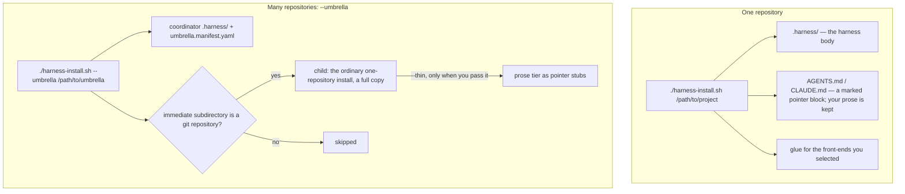
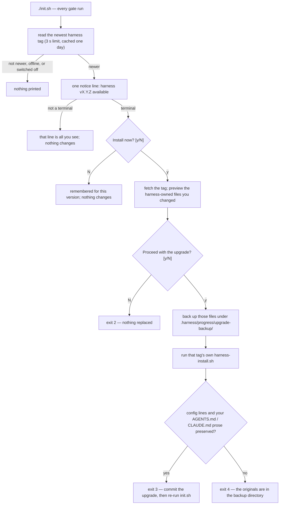

# Docs for humans, slice 2: INSTALL split — Technical Plan

> Translates the .spec.md intent into design. Every table row cites the `R-id`(s) it serves
> or the `ADR-NNNN` that defers it (ADR-0009) — this plan must exit `0` under
> `tools/plan-cite-check.py` and the feature directory under `tools/readiness-check.py`
> (every first cell below exists today or has `create` as the first word of its Change cell).
> The Builder reads `progress/lessons.md` first (the two 2026-11-13 slice-1 lessons apply
> directly: grep every absolute in a human doc against the contract that owns it; plant one
> defect per scan-set member). Exact prose the Builder pastes is in *Approach notes → Exact
> text*, inside fenced blocks (fenced text is invisible to the readiness lint). A relative
> link target written in this file outside a fence carries a `<docs>/` or `<agents>/`
> placeholder so the lint does not read it as a repository path.

## Stack & dependencies

- Language/framework: Markdown + Mermaid (GitHub-rendered); POSIX `sh` + `awk` + `python3`
  (stdlib only) inside `tests/test_docs_for_humans.sh`, run under dash by `tools/run-tests.sh`.
  The two slice-1 tools are **used, not changed** (D7).
- New dependencies: **none**. No mermaid-cli.
- Inputs: `docs/INSTALL.md` at the merge base (`git show <base>:docs/INSTALL.md`) is the
  source of the counterpart — copy it, never retype it. No art.
- Repo root for every command: the `feat/E39-F02-install-split` worktree. Board writes carry
  `HARNESS_DIR=<worktree>`; the Builder never writes the board.
- **Test-runner slot.** One `run-tests.sh` at a time on this machine, `--jobs ≤ 4`. While
  iterating run only the suites you touched, one at a time (`sh tests/test_docs_for_humans.sh`
  first, then each re-pointed suite in the coupling table, then `sh tests/test_install.sh`,
  `sh tests/test_suite_hygiene.sh`, `sh tests/test_self_drift.sh`). The full
  `sh tools/run-tests.sh` once, serially, before hand-off; never relaunch a killed run.
  `TMPDIR` for the suites: a path with no ancestor relationship to the repo
  (`/var/tmp/E39-F02-builder/`, created first).

## Data model  (serves: R1, R2, R3, R4, R5, R8, R10)

No stored state. The data model is the set of file contracts the suite reads.

| Entity | Form (byte-exact where quoted) | Where the grammar is silent | R-id |
|---|---|---|---|
| counterpart | `docs/agents/INSTALL.md`: line 1 `# Installing the harness into a project`; first non-empty line after it the announcement (text A); then the 0.110 body verbatim | the announcement is the only added text; blank lines around it are free | R1 |
| heading list | the ordered `#`/`##`/`###` lines outside fenced code — exactly the 48 lines of *Heading list* below | `#### ` and deeper do not occur in the base doc | R1 |
| retargeted link | from `docs/agents/`: `#x` kept; `./X.md…` → `../X.md…`; `X.md…` (no `./`) → `../X.md…`; `../specs/…` → `../../specs/…`; the telemetry line's target → `README.md#observability-telemetry` | link **text** never changes (C2); exactly these targets differ from base | R1 |
| human doc | `docs/INSTALL.md`: H1 on line 1; counterpart link `](agents/INSTALL.md)` within lines 1–15; the eight `##` headings of R2 in order and no other `##`; `###` free | ≤300 lines; registered `docs/INSTALL.md:300:yes` (see *Exact text*, text F) | R2, R10 |
| further-reading anchor | `](agents/INSTALL.md#<slug>)` for each of the ten slugs in R2 | written in `## Further reading`; one per line is easiest to lint but not required | R2 |
| diagram pin | `## Install`: one fence whose info string is `mermaid`, first content line starts `flowchart`, two `subgraph` lines, the eight tokens of R3; `## Upgrade`: one `mermaid` fence, `flowchart`, the ten tokens of R4 | diagrams are text B and text C; the Builder may add nodes, never drop a pinned token | R3, R4 |
| sentence pin | S1–S7 (text D) each matched by the regex in the *Accuracy table*, applied to the doc folded to one line outside fences | wording outside the regex is free; the regex is the contract | R5 |
| over-claim | none of the strings in R5's negative list, case-insensitive, outside fences, in `docs/INSTALL.md`; `uninstall` also absent from `docs/README.md` | — | R5 |
| anchor | a link target `<path>.md#<frag>` or `#<frag>` (inline `](…)` or a reference definition) outside fences in `README.md` or `docs/**/*.md`; resolves iff `<frag>` ∈ slugs of the target's headings outside fences | slug(h) = lowercase(h stripped of leading `#`s and surrounding space) with every char not in `[a-z0-9 _-]` dropped, spaces → `-` (the `tools/doc-cite-check.py` rule; backticks, `—`, `(`, `)`, `=`, `:`, `/` vanish, so `## Layout & ownership` → `layout--ownership`) | R8 |
| registry entry | `HUMAN_DOCS` gains the token `docs/INSTALL.md:300:yes` | default budget, no `# why:` comment needed | R10 |
| index row | text E, appended under the existing README row | the "What moved" cell is free text | R10 |

## API / interface  (serves: R6, R7, R8, R9, R10, R11)

| Interface | Shape | R-id |
|---|---|---|
| `tests/test_docs_for_humans.sh` new rows | functions `F02_R1_counterpart_announcement`, `F02_R1_counterpart_headings_in_order`, `F02_R1_counterpart_retargets`, `F02_R2_human_shape`, `F02_R3_install_diagram`, `F02_R4_upgrade_diagram`, `F02_R5_accuracy_sentences`, `F02_R5_no_over_claims`, `F02_R6_suites_cite_counterpart`, `F02_R7_no_stale_citations`, `F02_R8_anchors_resolve`, `F02_R10_registry_and_index`, `F02_R11_version_and_changelog`; dispatched from the flat list; the "defined but not dispatched" sweep's `sed` pattern widened to `^\(\(F[0-9]*_\)\{0,1\}R[0-9][0-9]*_[A-Za-z0-9_]*\)() *{.*` so the new rows are swept too | R1–R5, R6, R7, R8, R10, R11 |
| `tests/test_docs_for_humans.sh` edited rows | `R9_relative_links_resolve` plants one broken link in each of `README.md`, `docs/README.md`, `docs/agents/README.md` of a `mirror` and requires three reports; `R2_no_assets_links_under_docs` plants one `assets/` link in `docs/README.md` and one in `docs/agents/README.md` of a private copy and requires both | R9 |
| `tests/test_install.sh` | `test_docs_for_humans_installed_contract`'s `cmp -s` list gains `docs/INSTALL.md docs/agents/INSTALL.md` (same loop, two more names); nothing else in the function changes | R10 |
| re-pointed suites | path-only substitution `docs/INSTALL.md` → `docs/agents/INSTALL.md` at the sites in the *Suite coupling table*; fail messages, patterns and anchors untouched (C3) | R6 |
| `harness-install.sh`, `init.sh`, `harness.config.yaml` | comment lines: `docs/INSTALL.md` → `docs/agents/INSTALL.md` (five, one, two lines); the `§ Per-role model routing` pointer then resolves against the counterpart's heading | R7 |
| sibling docs | anchored link targets: from `docs/X.md`, `INSTALL.md#s` / `./INSTALL.md#s` → `agents/INSTALL.md#s`; from `docs/agents/README.md`, `../INSTALL.md#s` → `INSTALL.md#s`; `docs/WORKFLOW.md`'s `` `docs/INSTALL.md`'s "Codex reasoning effort" section `` → `` `docs/agents/INSTALL.md`'s … `` | R7 |
| `VERSION` / `CHANGELOG.md` | `0.110.1` → `0.111.0` unless `origin/main` moved (`git show origin/main:VERSION` before the final rebase; always next MINOR, patch 0); `## [0.111.0] — <date>` with text G | R11 |

**Decision — the counterpart is a copy, not a composition (D1).** `git show <base>:docs/INSTALL.md > docs/agents/INSTALL.md`, insert text A after line 1, then apply only the link retargets. Anything else is a C2 violation and `docs-move-check.sh` will show it as a `DROPPED-LINE`.
**Decision — anchored links follow the heading, plain links stay (D2).** The lint that enforces it is R8; D2 is what makes R8 pass.
**Decision — pins are two-token regexes on folded text (R5).** The slice-1 shape (`R3_gate_exceptions`): a regex that needs two tokens of the sentence in order, so a reworded sentence that keeps the meaning passes and a dropped exception reds.
**Decision — no `E00-F01` in the human doc.** The archaeology lint forbids feature ids; the bootstrap task is "the seeded bootstrap task".

## Files to change  (serves: R1–R11)

| File | Change | R-id |
|---|---|---|
| `docs/agents/INSTALL.md` | **create** — `git show <base>:docs/INSTALL.md`, then insert text A as a blockquote after the H1 (one blank line each side), then retarget links: the two `./UMBRELLA.md#…` targets and the `./CONFIG-LAYERING.md` target → `../UMBRELLA.md#…` / `../CONFIG-LAYERING.md`; `../specs/adr/0002-…` → `../../specs/adr/0002-…`; the telemetry sentence's `(../README.md)` → `(README.md#observability-telemetry)`; every in-page `(#…)` kept. Nothing else differs from base | R1 |
| `docs/INSTALL.md` | **rewrite** — ≤300 lines; the human guide per *Human doc skeleton*: H1, intro with the counterpart link, the eight `##` sections of R2, diagrams text B (in `## Install`) and text C (in `## Upgrade`), sentences S1–S7 (text D) in their sections, `## Further reading` with the ten anchors; `## Bootstrap (first run)` kept as a heading; no link target outside `docs/`; none of R5's over-claims; no feature ids | R2, R3, R4, R5 |
| `docs/README.md` | **modify** — the INSTALL row: `Install the harness into a project, choose front-ends, upgrade, uninstall.` → `Install the harness into a project, choose front-ends, upgrade.` (one word removed) | R5 |
| `docs/agents/README.md` | **modify** — append index row text E under the README row; retarget the seven anchored INSTALL links (lines citing `#retiring-gemini` ×2, `#staying-current--the-update-check-e38-f01`, `#starting-from-nothing-new-product` ×2, `#self-mode----self-harness-developers-only`, `#bootstrap-first-run`) from `../INSTALL.md#…` to `INSTALL.md#…`; link text unchanged | R7, R10 |
| `docs/HARNESS.md` | **modify** (D2, path-only) — three targets `INSTALL.md#starting-from-nothing-new-product`, `INSTALL.md#self-mode----self-harness-developers-only`, `INSTALL.md#retiring-gemini` → `agents/INSTALL.md#…`; the plain `INSTALL.md` link stays | R7 |
| `docs/UMBRELLA.md` | **modify** (D2, path-only) — `./INSTALL.md#umbrella-mode-cascade-install` → `./agents/INSTALL.md#umbrella-mode-cascade-install` | R7 |
| `docs/WORKFLOW.md` | **modify** (D2, path-only) — `INSTALL.md#sdd-pr-loop-opt-in-gated-on-pr_loopenabled` → `agents/INSTALL.md#…`; the title pointer `` `docs/INSTALL.md`'s "Codex reasoning effort" section `` → `` `docs/agents/INSTALL.md`'s "Codex reasoning effort" section ``; the plain `INSTALL.md` link stays | R7 |
| `docs/CONFIG-LAYERING.md` | **modify** (D2, path-only) — `./INSTALL.md#worker-roster-workersroster--opt-in-local-only` → `./agents/INSTALL.md#…`; the plain `./INSTALL.md` link stays | R7 |
| `docs/BASELINE-0.78.1.md` | **modify** (D2, path-only) — `INSTALL.md#layout--ownership` → `agents/INSTALL.md#layout--ownership`; the plain `INSTALL.md` link stays | R7 |
| `harness-install.sh` | **modify** — six comment lines (the two `#   docs/INSTALL.md.` lines of the `pin.*` comment block, the `§ Per-role model routing` design note, the Codex trust comment, the round-7 consistency-audit comment, the `HARNESS_PR_LOOP_ENABLED` comment): `docs/INSTALL.md` → `docs/agents/INSTALL.md`; no emitter and no printed string touched; `sh harness-install.sh --self` must produce no diff | R7 |
| `init.sh` | **modify** — the one comment (`contradicted the docs/INSTALL.md promise`): path only | R7 |
| `harness.config.yaml` | **modify** — the two `#   docs/INSTALL.md.` comment lines in the `models:` block: path only (this is the seed the installer copies; the heredoc twin in `harness-install.sh` is one of the six lines above) | R7 |
| `tests/test_docs_for_humans.sh` | **modify** — registry entry text F; new rows per *API*; `broken_links()` and `links_into_assets()` unchanged, their rows `R9_relative_links_resolve()` and `R2_no_assets_links_under_docs()` gain the per-member plants; the dispatch sweep widened; the header comment gains one line naming E39-F02 | R1–R5, R6, R7, R8, R9, R10, R11 |
| `tests/test_install.sh` | **modify** (C3 + R10) — the E23 three-docs loop `"$SRC/docs/INSTALL.md"` → `"$SRC/docs/agents/INSTALL.md"`; the installed-copy sites (`_mi`, `_im11`, `_im11_install`, `_bl11`) `.harness/docs/INSTALL.md` → `.harness/docs/agents/INSTALL.md`; `test_docs_for_humans_installed_contract()` loop gains the two INSTALL names | R6, R10 |
| `tests/test_agents_host.sh` | **modify** (C3) — four sites: the host-mode row's installed `_mi`, the two `_doc=` assignments of the fresh-default and re-toggle rows, and the installed re-toggle grep | R6 |
| `tests/test_escalation.sh` | **modify** (C3) — eight sites: the four `for _d in …` lists, the two `awk … "$SRC/docs/INSTALL.md"` extractions, the `for _d in "$SRC/docs/INSTALL.md" "$SRC/docs/WORKFLOW.md"` loop, the installed `_in=` read | R6 |
| `tests/test_feedback_config.sh` | **modify** (C3) — the three `_section` / `folded_section` calls | R6 |
| `tests/test_feedback_report.sh` | **modify** (C3) — the `_section` call, the `grep -cF 'Reporting stays inert until'` working-file read, the `git show "$_base:docs/INSTALL.md"` and the `cmp -s` (the base-liveness control is informational by its own design and reads N/A until merge) | R6 |
| `tests/test_greenfield.sh` | **modify** (C3) — `DOC="$SRC/docs/INSTALL.md"` only; the `$README` grep for `docs/INSTALL.md#bootstrap-first-run` is untouched | R6 |
| `tests/test_installer_toggles.sh` | **modify** (C3) — the two `_doc="$SRC/docs/INSTALL.md"` sites | R6 |
| `tests/test_opencode_compat.sh` | **modify** (C3) — `INSTALL="$SRC/docs/INSTALL.md"` | R6 |
| `tests/test_pi_agents.sh` | **modify** (C3) — the two five-docs loops and the two R11d greps | R6 |
| `tests/test_pi_front.sh` | **modify** (C3) — the five-docs loop | R6 |
| `tests/test_pi_integrity.sh` | **modify** (C3) — the `### pi` awk extraction | R6 |
| `tests/test_pi_preflight.sh` | **modify** (C3) — the `### pi` awk extraction | R6 |
| `tests/test_pr_loop.sh` | **modify** (C3) — the seven sites of `test_docs_document_pr_loop` (two lists, five greps) | R6 |
| `tests/test_promote.sh` | **modify** (C3) — `INSTALL_DOC="$SRC/docs/INSTALL.md"` | R6 |
| `tests/test_reporting_rule.sh` | **modify** (C3) — the `_section` call | R6 |
| `tests/test_sdd_fix_parallel.sh` | **modify** (C3) — the `for f in README.md docs/WORKFLOW.md docs/INSTALL.md` list | R6 |
| `tests/test_init_drift_guard.sh` | **modify** (comment only) — `docs/INSTALL.md commits the planning baseline` → `docs/agents/INSTALL.md …` | R6 |
| `tests/test_planner_topology.sh` | **modify** (comment only) — same substitution | R6 |
| `VERSION` | **bump** to the next MINOR over the then-current `origin/main` value (`0.110.1` today ⇒ `0.111.0`). Before bumping, `grep -rn '0\.110\.1' tests/ tools/ init.sh harness-install.sh` — expect none; keep it so | R11 |
| `CHANGELOG.md` | **prepend** `## [0.111.0] — <date>` (text G) | R11 |

## Deferred  (ADR-0009 — bolt-ons the stage excludes)

Stage: `production` (this repo's `specs/product.md`).

Deferred: none — stage is production, and this feature's runtime surface is documentation
plus rows in a read-only lint; no bolt-on NFR applies to it.

## DO NOT TOUCH

- `README.md`, `docs/CONCEPTS.md`, `docs/BRAND.md`, `AGENTS.md`, `CLAUDE.md`, `agents/*.md`,
  every `tools/*` (the two slice-1 tools included — D7), `tests/lib/fence.awk`,
  `tests/fixtures/doc-cite/`, `store/`, `state/tasks.json`, `specs/_templates/`, `assets/`.
- `docs/HARNESS.md`, `docs/UMBRELLA.md`, `docs/WORKFLOW.md`, `docs/CONFIG-LAYERING.md`,
  `docs/BASELINE-0.78.1.md`, `docs/SPEC-FORMAT.md`, `docs/RATIONALE.md`, `docs/ABLATION.md` —
  F03–F05's files: byte-identical before and after **except** the anchor-target lines R7
  names (`git diff --stat <base> -- docs/HARNESS.md …` shows exactly 3/1/2/1/1 changed lines
  for the five named docs and nothing for the other three). Record `cksum` of the three
  untouched ones at T0 and at hand-off, never `git diff … main` inside a suite.
- Every suite not named in *Files to change*; inside the named suites, every line that is not
  a `docs/INSTALL.md` path site (C3: patterns, anchors, fail messages unchanged).
- `.claude/**`, `.codex/**`, `.opencode/**`, `.pi/**`, `.agents/**` — generated; run
  `sh harness-install.sh --self` once at the end and confirm an empty diff.
- The moved text in `docs/agents/INSTALL.md` — copied, never edited (link targets excepted).

## Approach notes

### Suite coupling table (R6)

Every suite that reads `docs/INSTALL.md`, its sites, and the disposition. Every site is
*re-point* (D1 moved every section); the one *keep* is the README assertion in
`tests/test_greenfield.sh`, which reads `README.md`, not INSTALL. Line numbers are those of the
merge base and are a finding aid only — grep the pattern, do not trust the number.

| Suite | Sites (base line) | What it pins | Disposition |
|---|---|---|---|
| `tests/test_agents_host.sh` | 830 (installed `_mi`), 1155, 1216 (`_doc`), 1232 (installed grep) | `--agents=host`, `HARNESS_HOST_AGENT`, `--print-agents`, `CLAUDECODE`, `no existing install`, `persisted`; `### The fresh-install default`; `### Changing the selection later` | re-point ×4 |
| `tests/test_escalation.sh` | 949, 967, 979, 1008 (lists), 1032, 1043 (awk), 1073 (loop), 1747 (installed) | `after_rejections` default; `### Codex reasoning effort` and `### \`builder-heavy\`` slices; F182 `claude=raise` sentences | re-point ×8 |
| `tests/test_feedback_config.sh` | 382, 385, 409 | `## Harness feedback (\`feedback:\`) — on by default` slice: the resolution grammar | re-point ×3 |
| `tests/test_feedback_report.sh` | 781, 800, 808, 810 | `## Harness feedback` slice; the `Reporting stays inert until` negative; the informational base-liveness control | re-point ×4 |
| `tests/test_greenfield.sh` | 132 (`DOC`) | `## Starting from nothing (new product)`, `## Bootstrap (first run)` slices, ordered steps, the cwd-correct `git init` | re-point ×1; line 310 (`$README`) keep |
| `tests/test_install.sh` | 2123 (loop), 2513 (installed `_mi`), 3191, 3204, 3228 (installed `doc_section`) | `$sdd-`, `.agents/skills`, `legacy`, `explicit`, `ownership`; `models:`, `reasoning`, `provider/model`, `.codex/agents/`; `Layout & ownership`, `Install`, `Body layout` slices | re-point ×5 (+ the R10 `cmp` extension) |
| `tests/test_installer_toggles.sh` | 669, 1437 | backend prompt tokens; `pr_loop.enabled` prompt tokens, `HARNESS_PR_LOOP_ENABLED` per-run | re-point ×2 |
| `tests/test_opencode_compat.sh` | 116 (`INSTALL`) | `Supported OpenCode versions`, `OpenCode model helper` slices | re-point ×1 |
| `tests/test_pi_agents.sh` | 1104, 1439 (loops), 1430, 1431 (greps) | `pin.pi.`, `thinking`, the tier table's two pi columns | re-point ×4 |
| `tests/test_pi_front.sh` | 648 | five-docs loop | re-point ×1 |
| `tests/test_pi_integrity.sh` | 675 | `### pi` slice: integrity-pin wording | re-point ×1 |
| `tests/test_pi_preflight.sh` | 1030 | `### pi` slice: preflight words, exit status 5 | re-point ×1 |
| `tests/test_pr_loop.sh` | 1998, 2002, 2004, 2007, 2010, 2013, 2015 | `/sdd-pr-loop`, `Codex GitHub App`, `pr_loop.enabled`, `enabled: false`, four knobs, four env vars, `jq` | re-point ×7 |
| `tests/test_promote.sh` | 22 (`INSTALL_DOC`) | `## Umbrella mode` span: `--from-manifest <file>`, `umbrella.manifest.draft.yaml`, `UMBRELLA.md` | re-point ×1 |
| `tests/test_reporting_rule.sh` | 662 | `## Harness feedback` slice | re-point ×1 |
| `tests/test_sdd_fix_parallel.sh` | 614 | `/sdd-fix-parallel` named | re-point ×1 |
| `tests/test_docs_for_humans.sh` | 191 (`KEPT_TOKENS`), 258 (`## Documentation` links) | README's `docs/INSTALL.md#bootstrap-first-run`; the README documentation link | keep — both read `README.md`; this suite gains the registry entry and the new rows |
| `tests/test_init_drift_guard.sh`, `tests/test_planner_topology.sh` | 151, 928 | comments: "`docs/INSTALL.md` commits the planning baseline only after `/sdd-drill`" | comment-only path edit |

### Accuracy table (R5)

Each human sentence, the counterpart section that owns the fact, and the regex the suite applies
to the human doc folded to one line outside fences. The Builder re-reads the owning section
before writing the sentence; a sentence that cannot be traced is not written.

| Id | Human sentence (text D) | Owning section in `docs/agents/INSTALL.md` | Regex pin |
|---|---|---|---|
| S1 | a single-repository install never runs `git init`; `cd` into the project first, then `git init` and commit | `## Starting from nothing (new product)` step 3 | `never runs .git init. for you` |
| S2 | off a terminal the check prints that one line and changes nothing; the gate's exit code is the same | `### Staying current — the update check (E38-F01)` ¶2 | `prints that one line and changes nothing` |
| S3 | nothing in the project is replaced until `y` twice: fetch and preview, then proceed | same section, *Answering `y`* | `until you answer .y. twice` |
| S4 | config (new default keys appended), `product.md`, `tasks.json`, epic specs, progress kept; a `product.md` never edited is refreshed to the new stub | `## Install` ¶ after the tree; `## Config migration on upgrade (non-destructive)` | `product\.md. you never edited, which is refreshed` |
| S5 | `init.sh` fails until the upgrade is committed; not a git work tree → skips; nothing under `.harness/` tracked → warns and goes on | `### Commit the upgrade — \`init.sh\` now checks that you did` (table) | `fails until the upgrade is committed` **and** `warns and goes on` |
| S6 | children are the umbrella's immediate subdirectories that are git repositories; each gets the ordinary single-repository install as a full copy; `--thin` converts a child only when you pass it | `## Umbrella mode (cascade install)` item 2; `### Body layout — \`--thin\` and \`--standalone\`` | `immediate subdirectories that are git repositories` **and** `only when you pass it` |
| S7 | an interactive install asks up to three questions; the second and third keep the current value on Enter; each has a flag for scripted installs | `## Starting from nothing (new product)` step 2; `## The second question — …`; `## The third question — …` | `keep the current value when you press Enter` |

Over-claims the row forbids (case-insensitive, outside fences): `uninstall`, `upgrades itself`,
`upgrades automatically`, `automatically upgrade`, `everything is preserved`,
`nothing is overwritten`, `the installer runs git init`, `E00-F01`. `docs/README.md`: `uninstall`.

### Heading list (R1)

The 48 heading lines of the 0.110 `docs/INSTALL.md` in order, byte for byte — the counterpart's
`unfenced | grep '^#'` output must equal this block exactly:

```text
# Installing the harness into a project
## Prerequisites
## Install
### Shared skill units and legacy prompt migration
### pi
### Retiring Gemini
## Starting from nothing (new product)
## Bootstrap (first run)
### `/sdd-pr-loop` (opt-in, gated on `pr_loop.enabled`)
## Host detection — `--agents=host` (opt-in)
### Which markers are trusted
### Declaring the host yourself — `HARNESS_HOST_AGENT`
### What happens when the host is undetected
### The fresh-install default
### Seeing what it would do — `--print-agents`
### Changing the selection later
## OpenCode parallel-fix support (`/sdd-fix-parallel`)
## Harness feedback (`feedback:`) — on by default
## Worker roster (`workers.roster`) — opt-in, local-only
## The second question — `execution.builder.backend`
### Scripted installs — `--builder-backend=` / `HARNESS_BUILDER_BACKEND`
### Choosing `delegate` before wiring `delegate_cmd`
## The third question — `pr_loop.enabled`
### Scripted installs — `--pr-loop=`
### `HARNESS_PR_LOOP_ENABLED` is per-run, and is never persisted
### No install-time preflight
### Changing either answer later
## Upgrade
### Commit the upgrade — `init.sh` now checks that you did
### Staying current — the update check (E38-F01)
## Umbrella mode (cascade install)
### Promoting a single install to a coordinator
### Shared spec repository (`--shared-repo`)
### Body layout — `--thin` and `--standalone`
## Per-role model routing (`models:`) — opt-in
### `builder-heavy` — the escalation tier
### What each tier stamps
### pi model and thinking (E35-F03)
### Codex reasoning effort — `model_reasoning_effort` (E99-F161)
### Pinning an exact model — `models.pin.<front-end>.<tier>`
### Where the values land
### Supported OpenCode versions
### OpenCode model helper
## Self mode — `--self` (harness developers only)
### Optional Codex Builder/heavy model choices
## Config migration on upgrade (non-destructive)
## Layout & ownership
## Fallback: AI-driven adoption
```

### Human doc skeleton (R2–R5)

Write it short, not trimmed afterwards. Every claim comes from the counterpart section named
in brackets; link that section from `## Further reading` when it is not in the body. No
feature ids, no round numbers, no filler phrases (the suite's list), no link that leaves `docs/`.

- **H1 + intro (lines 1–8).** `# Installing the harness` — one paragraph: installs into any repo
  as a self-contained `.harness/` plus thin pointers; install and upgrade are the same
  idempotent command; the five front-ends in priority order [intro]. Second paragraph, one
  line: `Exact contracts — exit codes, flags, edge cases — are in [agents/INSTALL.md](agents/INSTALL.md).`
- **`## Prerequisites`** — Unix shell; `python3` with stdlib `fcntl` (`init.sh` fails without
  it); no third-party Python packages; Node optional for task selection (prose fallback) and
  required for board mirrors; `gh`, `jq` and the Codex GitHub App only when the PR loop is on
  [`## Prerequisites`].
- **`## Install`** — the one command (`./harness-install.sh /path/to/your-project` from a
  harness checkout); text B; S7 and the three flags `--agents=`, `--builder-backend=`,
  `--pr-loop=` [`## Starting from nothing` step 2, the two question sections]; what lands: the
  body under `.harness/`, a marked pointer block in `AGENTS.md`/`CLAUDE.md` with your prose kept,
  glue only for selected front-ends [`## Install`]. One sentence on telemetry: the zero-dependency
  reporter ships in `tools/`; link `agents/README.md#observability-telemetry` (the corrected
  pointer, D4).
- **`## Choose your front-ends`** — keys `claude`, `codex`, `opencode`, `antigravity`, `pi`;
  `--agents=<csv>`, `HARNESS_AGENTS`, `--agents=host` (whole value only), `--agents=all`,
  `--print-agents` (read-only preview); fresh unattended default Claude; upgrades keep the
  selection recorded in `.harness/.agents`; re-run to add or remove [`## Host detection …` and
  its `###`s]. Do **not** describe the marker table or the retired-host rules — link them.
- **`## Bootstrap (first run)`** — new product: S1, then edit `.harness/specs/product.md`,
  `/sdd-plan`, `/sdd-drill <epic-id>`, commit the planning baseline, first feature branch,
  `/sdd-next` [`## Starting from nothing`]. Existing project: `/sdd-next` routes the seeded
  bootstrap task to the Architect to detect your test/lint/typecheck commands and pauses at the
  human gate; later work enters with `/sdd-new "<idea>"` [`## Bootstrap (first run)`]. Name the
  task by role, never by id.
- **`## Upgrade`** — manual path: `cd` the harness checkout, `git pull`, re-run
  `./harness-install.sh --agents=<your selection> /path/to/your-project` [`## Upgrade`]; S4;
  text C; S2, S3; the notice is remembered per version (the question stops, the line keeps
  printing) and the remote is read at most once a day; switches `update.check: false`,
  `HARNESS_SKIP_UPDATE_CHECK=1`, `update.remote` [`### Staying current …`]; exit `5` is a fetch
  or installer failure; S5 and `HARNESS_SKIP_DRIFT_CHECK=1` [`### Commit the upgrade …`].
  Never write "automatic", "itself" or "silently" about the upgrade.
- **`## Umbrella (many repositories)`** — one command `--umbrella /path/to/umbrella-dir`;
  S6; the coordinator's `.harness/` and `umbrella.manifest.yaml`; `--shared-repo` makes the
  umbrella root a spec repository; `--from-manifest` promotes a planned single install; link
  `UMBRELLA.md` for the rest [`## Umbrella mode (cascade install)` and its `###`s]. Say
  "immediate subdirectories", never "recursively" (`--recursive` is accepted but scans depth 1).
- **`## Ownership`** — a three-row table: harness-owned and refreshed
  (`.harness/{AGENTS.md,agents,docs,store,tools,specs/_templates,init.sh}` and generated
  glue); yours and preserved (`harness.config.yaml` with keys appended, `init.project.sh`,
  `specs/product.md`, `specs/glossary.md`, `specs/epics`, `state/tasks.json`, `progress`);
  local and gitignored (`telemetry.jsonl`, `workers.json`) [`## Layout & ownership`].
- **`## Further reading`** — one line per anchor of R2 (ten), each saying in five words what
  the section decides; plus `UMBRELLA.md`, `CONFIG-LAYERING.md`, `WORKFLOW.md`.

### Sequencing

1. T0 cksums (the three untouched F03–F05 docs, every `agents/*.md`, `tools/*`, `README.md`,
   `docs/CONCEPTS.md`, `docs/BRAND.md`). Create the counterpart by **copying** the base file
   (`git show`), insert text A, retarget links — do the move before the human doc so
   `docs-move-check.sh <base>` is your own red/green signal (`0 vanished tokens, 0 dropped
   lines` once the human doc is rewritten; before that, `0 human docs examined`).
2. Re-point the 17 suites + 2 comments with a path-only `sed` on the listed sites; run each
   suite one at a time; confirm the shape with the R6 `git diff -U0 … | uniq -u` command.
3. Registry entry, index row, installed-contract extension; `sh tests/test_docs_for_humans.sh`
   now reds on the human doc (counterpart link, budget) — write the human doc per the skeleton.
4. Installer / `init.sh` / config comment edits; sibling-doc anchor retargets; `python3
   tools/doc-cite-check.py` exit 0.
5. New rows (anchors, scan-set plants, pins), VERSION/CHANGELOG, `--self`, full suite.

### Exact text

**Text A — announcement (lines 1–3 of `docs/agents/INSTALL.md`; line 1 is the base H1):**

```markdown
# Installing the harness into a project

> For agents — exact contracts; the human guide is [docs/INSTALL.md](../INSTALL.md).
```

**Text B — the install diagram (`## Install`; the Builder may add nodes, never drop a pinned token):**



**Text C — the upgrade diagram (`## Upgrade`):**



**Text D — the seven pinned sentences (paste; surrounding prose is free):**

```markdown
S1  A single-repository install never runs `git init` for you: `cd` into the project first, then `git init` and commit.
S2  Away from a terminal the check prints that one line and changes nothing: the gate's exit code is the same as without it.
S3  Nothing in your project is replaced until you answer `y` twice — once to fetch and preview, once to proceed.
S4  Your `harness.config.yaml` (new default keys are appended), `product.md`, `tasks.json`, epic specs and progress are kept; the one exception is a `product.md` you never edited, which is refreshed to the new stub.
S5  `init.sh` fails until the upgrade is committed. On a project that is not a git work tree it skips the check; when nothing under `.harness/` is tracked it warns and goes on.
S6  Children are the umbrella's immediate subdirectories that are git repositories; each gets the ordinary single-repository install as a full copy, and `--thin` converts a child to pointer stubs only when you pass it.
S7  An interactive install asks up to three questions — front-ends, builder backend, PR loop. The second and third keep the current value when you press Enter, and each has a flag for scripted installs.
```

**Text E — the index row (`docs/agents/README.md` → `## Index`, after the README row):**

```markdown
| `docs/INSTALL.md` | `docs/agents/INSTALL.md` | The whole 0.110 INSTALL: prerequisites, install and layout, skill units, pi, Gemini retirement, the new-product and bootstrap sequences, the PR-loop gate, host detection, the three questions, feedback, worker roster, upgrade and the update check, umbrella mode, model routing, self mode, config migration, layout and ownership |
```

**Text F — the registry line (`tests/test_docs_for_humans.sh`):**

```sh
HUMAN_DOCS="README.md:150:yes docs/README.md:60:no docs/CONCEPTS.md:220:yes docs/BRAND.md:90:no docs/INSTALL.md:300:yes"
```

**Text G — CHANGELOG entry skeleton:**

```markdown
## [0.111.0] — <date>

### Changed — docs for humans, slice 2: INSTALL split (E39-F02)
- `docs/INSTALL.md` rewritten for humans (≤300 lines): one repository or an umbrella in one
  command (diagram), the upgrade flow from update check to preservation proof (diagram), what
  is yours and what the harness refreshes.
- `docs/agents/INSTALL.md` — the 0.110 INSTALL moved verbatim (every section, headings
  byte-identical, link targets retargeted). 17 suites, the installer's, `init.sh`'s and the
  config's comments and every heading-anchored link re-point by path only.
- `tests/test_docs_for_humans.sh` — anchor lint (every `file.md#fragment` link under `README.md`
  and `docs/` resolves to a heading) and per-member scan-set pins for the link and assets rows.
- Corrected: INSTALL's telemetry pointer now targets `docs/agents/README.md` → Observability;
  `docs/README.md` no longer claims an uninstall.
```
