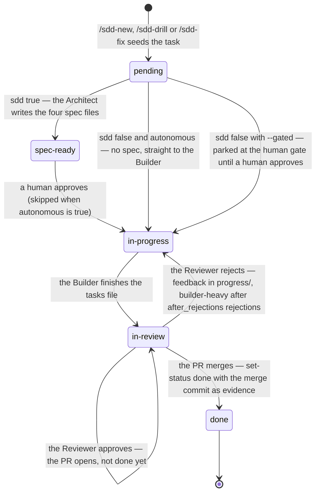
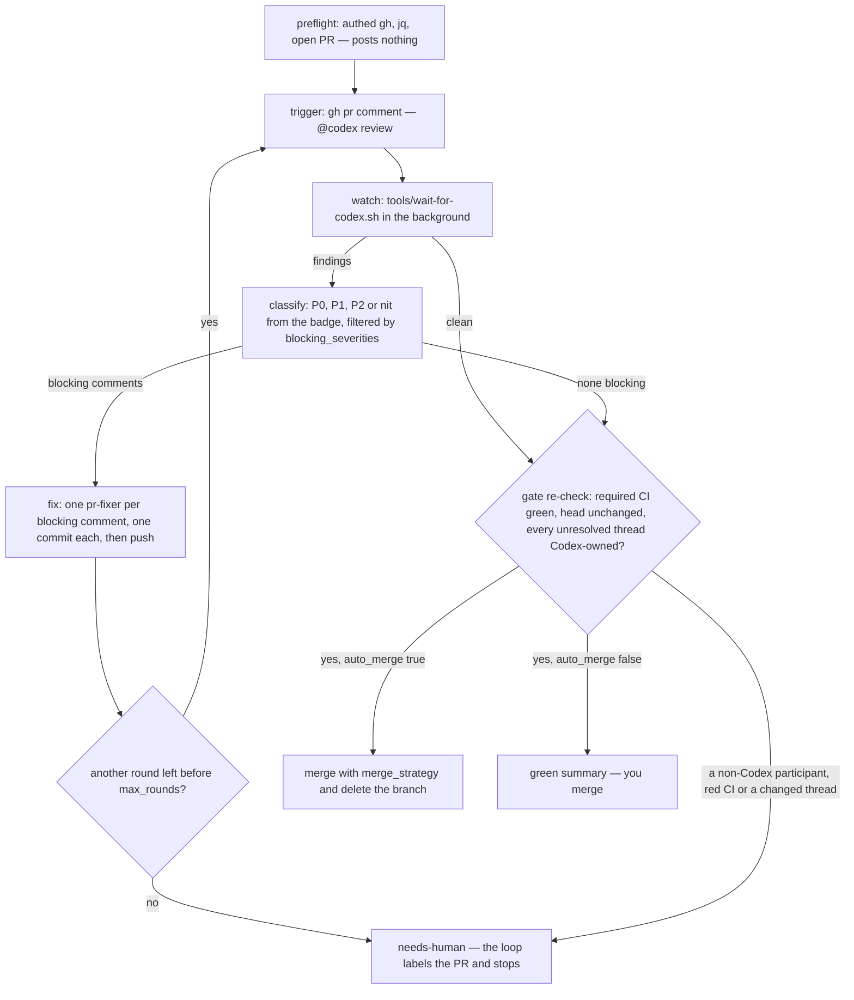

# Docs for humans, slice 3: WORKFLOW split — Technical Plan

> Translates the .spec.md intent into design. Every table row cites the `R-id`(s) it serves
> or the `ADR-NNNN` that defers it (ADR-0009) — this plan must exit `0` under
> `tools/plan-cite-check.py` and the feature directory under `tools/readiness-check.py`
> (every first cell below exists today or has `create` as the first word of its Change cell).
> The Builder reads `progress/lessons.md` first (the two 2026-11-13 slice-1 lessons apply
> directly: grep every absolute in a human doc against the contract that owns it; plant one
> defect per scan-set member). Exact prose the Builder pastes is in *Approach notes → Exact
> text*, inside fenced blocks (fenced text is invisible to the readiness lint). A relative
> link target written in this file outside a fence carries a `<docs>/` or `<agents>/`
> placeholder so the lint does not read it as a repository path.

## Stack & dependencies

- Language/framework: Markdown + Mermaid (GitHub-rendered); POSIX `sh` + `awk` + `python3`
  (stdlib only) inside `tests/test_docs_for_humans.sh`, run under dash by `tools/run-tests.sh`.
  The two slice-1 tools are **used, not changed** (D6).
- New dependencies: **none**. No mermaid-cli.
- Inputs: `docs/WORKFLOW.md` at the merge base (`git show <base>:docs/WORKFLOW.md`) is the
  source of the counterpart — copy it, never retype it. No art.
- Repo root for every command: the `feat/E39-F03-workflow-split` worktree. Board writes carry
  `HARNESS_DIR=<worktree>`; the Builder never writes the board.
- **Test-runner slot.** One `run-tests.sh` at a time on this machine, `--jobs ≤ 4`. While
  iterating run only the suites you touched, one at a time (`sh tests/test_docs_for_humans.sh`
  first, then each re-pointed suite in the coupling table, then `sh tests/test_install.sh`,
  `sh tests/test_suite_hygiene.sh`, `sh tests/test_self_drift.sh`). The full
  `sh tools/run-tests.sh` once, serially, before hand-off; never relaunch a killed run.
  `TMPDIR` for the suites: a path with no ancestor relationship to the repo
  (`/var/tmp/E39-F03-builder/`, created first).

## Data model  (serves: R1, R2, R3, R4, R5, R7, R9)

No stored state. The data model is the set of file contracts the suite reads.

| Entity | Form (byte-exact where quoted) | Where the grammar is silent | R-id |
|---|---|---|---|
| counterpart | `docs/agents/WORKFLOW.md`: line 1 `# The Workflow`; first non-empty line after it the announcement (text A); then the 0.111 body verbatim | the announcement is the only added text; blank lines around it are free | R1 |
| heading list | the ordered `#`/`##`/`###` lines outside fenced code — exactly the 37 lines of *Heading list* below | `#### ` and deeper do not occur in the base doc; the two base Mermaid blocks are inside fences and stay | R1 |
| retargeted link | from `docs/agents/`: `#whole-project-inception-sdd-plan` kept; `../agents/fixer.md` → `../../agents/fixer.md`; `../store/local.md` → `../../store/local.md`; `../specs/adr/0002-builder-heavy-is-a-tier-not-a-second-prompt.md` → `../../specs/adr/0002-…`; `INSTALL.md` → `../INSTALL.md`; `agents/INSTALL.md#sdd-pr-loop-opt-in-gated-on-pr_loopenabled` → `INSTALL.md#sdd-pr-loop-opt-in-gated-on-pr_loopenabled` | link **text** never changes (C2); exactly these six targets differ from base; the backtick token `docs/agents/INSTALL.md` in the escalation section is a root-relative path and is untouched | R1 |
| move proof | `tools/docs-move-check.sh <base>`: exit 0; summary `0 vanished tokens, 6 dropped lines, <M> moved lines, 4 human docs examined`; the four are the human docs (`README.md` and top-level `docs/*.md`) that differ from the base — `docs/WORKFLOW.md`, `docs/RATIONALE.md`, `docs/SPEC-FORMAT.md`, `docs/UMBRELLA.md`; the six `DROPPED-LINE` lines name `docs/RATIONALE.md:99`, `:105`, `:109`, `:115`, `docs/SPEC-FORMAT.md:123`, `docs/UMBRELLA.md:424` | `<M>` is not pinned; the Reviewer runs it (a suite never diffs `main`) | R1 |
| human doc | `docs/WORKFLOW.md`: H1 on line 1; counterpart link `](agents/WORKFLOW.md)` within lines 1–15; the seven `##` headings of R2 in order and no other `##`; `###` free | ≤300 lines; registered `docs/WORKFLOW.md:300:yes` (text F) | R2, R9 |
| further-reading anchor | `](agents/WORKFLOW.md#<slug>)` for each of the ten slugs in R2 (slugs computed by the `tools/doc-cite-check.py` rule from the *Heading list*) | written in `## Further reading`; one per line is easiest to lint but not required | R2 |
| state diagram | `## The feature state machine`: one fence whose info string is `mermaid`, first content line `stateDiagram-v2`, the ten tokens of R3; exactly one line matching `--> done` and it contains `merge`; no line contains `done: Reviewer approves` | text B; the Builder may add states or notes, never drop a pinned token; the prose names `sdd: true`, `sdd: false`, `--gated` | R3 |
| PR-loop diagram | `## The PR review loop`: one `mermaid` fence, first content line starts `flowchart`, the twelve tokens of R4; the prose names `/sdd-pr-loop`, `pr_loop.enabled`, `max_rounds`, `needs-human` | text C; same freedom | R4 |
| sentence pin | S1–S10 (text D), each matched by the regex in the *Accuracy table*, applied to the doc folded to one line outside fences | wording outside the regex is free; the regex is the contract | R5 |
| over-claim | none of the nine strings in R5's negative list, case-insensitive, outside fences, in `docs/WORKFLOW.md` | — | R5 |
| agent citation | `agents/orchestrator.md`, `agents/fixer.md`: zero lines contain `docs/WORKFLOW.md`; `AGENTS.md`: exactly one (the human row), immediately followed by text H; the emitter line in `harness-install.sh` is text I; each generated `sdd-next` body contains `docs/agents/WORKFLOW.md` | the emitter's `.harness/` prefix is stripped by `--self` for the source tree, as today | R7 |
| registry entry | `HUMAN_DOCS` gains the token `docs/WORKFLOW.md:300:yes` | default budget, no `# why:` comment needed | R9 |
| index row | text E, appended under the INSTALL row | the "What moved" cell is free text | R9 |

## API / interface  (serves: R2, R3, R4, R5, R6, R7, R8, R9, R10)

| Interface | Shape | R-id |
|---|---|---|
| `tests/test_docs_for_humans.sh` new rows | functions `F03_R1_counterpart_announcement`, `F03_R1_counterpart_headings_in_order`, `F03_R1_counterpart_retargets`, `F03_R2_human_shape`, `F03_R3_state_diagram`, `F03_R4_pr_loop_diagram`, `F03_R5_accuracy_sentences`, `F03_R5_no_over_claims`, `F03_R6_suites_cite_counterpart`, `F03_R7_agent_citations`, `F03_R8_sibling_citations`, `F03_R9_registry_and_index`, `F03_R10_version_and_changelog`; dispatched from the flat list under a `# ---- E39-F03` comment; the slice-2 sweep pattern already matches `F03_` names | R1–R10 |
| `tests/test_docs_for_humans.sh` generalised helpers (D6) | `install_shape_problems <file>` becomes `shape_problems <file> <want-headings> <anchors> <counterpart-basename>` (the fourth argument names the counterpart the 15-line link check looks for — a mutant copy is named `a.md`, so the name cannot be read from the file; the budget 300, the H1 rule, the `DOCS_DIR` escape check are unchanged); `F02_R2_human_shape` passes its eight headings and `$HUMAN_INSTALL_ANCHORS`; `diagram_problems <doc> <heading> <tokens> <prose> [<type>]` — the fifth argument defaults to `flowchart` so every slice-2 call is unchanged; `F03_R3_state_diagram` passes `stateDiagram-v2` | R2, R3, R4 |
| `tests/test_docs_for_humans.sh` edited row | `F02_R7_no_stale_citations` / `stale_citations <root>`: `"$1/docs/WORKFLOW.md"` → `"$1/docs/agents/WORKFLOW.md"`, the fail text's path likewise; the mutant setup copies `docs/agents/WORKFLOW.md` into `$T/f7/docs/agents/` and seds that copy | R9 |
| `tests/test_install.sh` | `test_docs_for_humans_installed_contract`'s `cmp -s` list gains `docs/WORKFLOW.md docs/agents/WORKFLOW.md` (same loop, two more names); nothing else in the function changes | R9 |
| re-pointed suites | whole-file `sed 's#docs/WORKFLOW\.md#docs/agents/WORKFLOW.md#g'` on each of the 31 suites in the *Suite coupling table*, run **once, before** the R9 loop extension (every `docs/WORKFLOW.md` token in those files is a content site, an installed-copy site, a comment or a fail message naming the path — none is a marker); afterwards the only `docs/WORKFLOW.md` token in any of the 31 is the extended `for _f in` line of `tests/test_install.sh`; patterns, anchors and fail-message wording untouched (C3) | R6 |
| `AGENTS.md` | step 4 `[the workflow](docs/WORKFLOW.md)` → `[the workflow](docs/agents/WORKFLOW.md)`; `See [human gates](docs/WORKFLOW.md).` → `See [human gates](docs/agents/WORKFLOW.md).`; text H inserted directly after the `docs/WORKFLOW.md` table row | R7 |
| `agents/orchestrator.md`, `agents/fixer.md` | the three citing lines: `docs/WORKFLOW.md` → `docs/agents/WORKFLOW.md`, path only | R7 |
| `harness-install.sh` | the `sdd-next.md` heredoc line (text I); then `sh harness-install.sh --self` rewrites the three generated bodies | R7 |
| sibling docs | `docs/RATIONALE.md` ×4: `` [`docs/WORKFLOW.md`](WORKFLOW.md) `` → `` [`docs/agents/WORKFLOW.md`](agents/WORKFLOW.md) `` (line 105 twice: the "cadence note" token and the link); `docs/SPEC-FORMAT.md:123`: `` `docs/WORKFLOW.md`. Four forms: `` → `` `docs/agents/WORKFLOW.md`. Four forms: ``; `docs/UMBRELLA.md:424`: `` see `docs/WORKFLOW.md` for the `` → `` see `docs/agents/WORKFLOW.md` for the ``; `docs/agents/INSTALL.md:1130`: `` See `docs/WORKFLOW.md` → "Which Builder runs". `` → `` See `docs/agents/WORKFLOW.md` → "Which Builder runs". ``; `docs/agents/README.md:156`: `(../WORKFLOW.md#diagnosing-blocked-selection)` → `(WORKFLOW.md#diagnosing-blocked-selection)` | R8 |
| `tests/test_readiness_check.sh` | the byte-pinned copy of SPEC-FORMAT's grammar section (the `pr-want.sec` heredoc): the same one-token edit as `docs/SPEC-FORMAT.md:123`, so the `spec_format_section` row (`test_readiness_check.sh`'s own id 11) stays green | R6, R8 |
| `VERSION` / `CHANGELOG.md` | `0.111.0` → `0.112.0` unless `origin/main` moved (`git show origin/main:VERSION` before the final rebase; always next MINOR, patch 0); `## [0.112.0] — <date>` with text G | R10 |

**Decision — the counterpart is a copy, not a composition (D1).** `git show <base>:docs/WORKFLOW.md > docs/agents/WORKFLOW.md`, insert text A after line 1, then apply only the six link retargets. Anything else is a C2 violation and `docs-move-check.sh` will show it as a `DROPPED-LINE` for `docs/WORKFLOW.md`, which R1 forbids.
**Decision — the citation class decides (D2).** The spec's decision table is the rule; this plan lists every site it yields. A site not in the table is a finding, not a judgment call.
**Decision — one sed per suite (R6).** Every `docs/WORKFLOW.md` token in a re-pointing suite moves, fail messages included; the `uniq -u` command in R6 is what proves nothing else moved.
**Decision — pins are one- or two-token regexes on folded text (R5).** The slice-1 shape (`R3_gate_exceptions`): a regex that needs the load-bearing tokens of the sentence in order, so a reworded sentence that keeps the meaning passes and a dropped exception reds.
**Decision — no feature ids in the human doc.** The archaeology lint forbids them; the maintenance epic is "the maintenance epic", the awaiting-merge park is "parked while its PR is open".

## Files to change  (serves: R1–R10)

| File | Change | R-id |
|---|---|---|
| `docs/agents/WORKFLOW.md` | **create** — `git show <base>:docs/WORKFLOW.md`, then insert text A as a blockquote after the H1 (one blank line each side), then retarget exactly the six link targets of the *Data model → retargeted link* row. Nothing else differs from base | R1 |
| `docs/WORKFLOW.md` | **rewrite** — ≤300 lines; the human guide per *Human doc skeleton*: H1, intro with the counterpart link, the seven `##` sections of R2, diagrams text B (in `## The feature state machine`) and text C (in `## The PR review loop`), sentences S1–S10 (text D) in their sections, `## Further reading` with the ten anchors; no link target outside `docs/`; none of R5's over-claims; no feature ids | R2, R3, R4, R5 |
| `docs/agents/README.md` | **modify** — append index row text E under the INSTALL row; retarget the one anchored WORKFLOW link (`#diagnosing-blocked-selection`) from `../WORKFLOW.md#…` to `WORKFLOW.md#…`; link text unchanged; the two plain pointers (lines 100, 379) and the C1 name example (line 25) untouched | R8, R9 |
| `docs/agents/INSTALL.md` | **modify** (D2, path-only) — the arming-verdict sentence's `` `docs/WORKFLOW.md` → "Which Builder runs" `` → `` `docs/agents/WORKFLOW.md` → "Which Builder runs" ``; the plain `Details: [WORKFLOW.md](../WORKFLOW.md).` line stays | R8 |
| `docs/RATIONALE.md` | **modify** (D4, path-only) — the four ledger rows C7, C13, D4, D10: `` [`docs/WORKFLOW.md`](WORKFLOW.md) `` → `` [`docs/agents/WORKFLOW.md`](agents/WORKFLOW.md) ``; on the C13 row also `` the `docs/WORKFLOW.md` cadence note `` → `` the `docs/agents/WORKFLOW.md` cadence note `` | R8 |
| `docs/SPEC-FORMAT.md` | **modify** (D4, path-only; lands in the same commit as the `tests/test_readiness_check.sh` copy, T2b) — the grammar sentence (line 123): `` `agents/architect.md` and `docs/WORKFLOW.md`. Four forms: `` → `` `agents/architect.md` and `docs/agents/WORKFLOW.md`. Four forms: ``; the line-248 pointer `` See `docs/WORKFLOW.md` for the state machine and the human-in-the-loop gate. `` stays | R8 |
| `docs/UMBRELLA.md` | **modify** (D4, path-only) — `` see `docs/WORKFLOW.md` for the `` → `` see `docs/agents/WORKFLOW.md` for the `` (the landing-record decision-table pointer) | R8 |
| `AGENTS.md` | **modify** — two link targets (step 4, the gate sentence) `docs/WORKFLOW.md` → `docs/agents/WORKFLOW.md`; text H inserted as the row directly after `| \`docs/WORKFLOW.md\` | State transitions and human gates |`; nothing else | R7 |
| `agents/orchestrator.md` | **modify** (path-only) — `(see the state machine in \`docs/WORKFLOW.md\`)` and `\`store/local.md\` (\`set_status\`) and \`docs/WORKFLOW.md\`.` → `docs/agents/WORKFLOW.md` | R7 |
| `agents/fixer.md` | **modify** (path-only) — `\`docs/WORKFLOW.md\` ("Selective SDD")` → `\`docs/agents/WORKFLOW.md\` ("Selective SDD")` | R7 |
| `harness-install.sh` | **modify** — the one heredoc line of the `sdd-next.md` command body (text I); no other emitter and no printed string touched; then `sh harness-install.sh --self` and commit the three regenerated bodies | R7 |
| `.claude/commands/sdd-next.md` | **regenerate** (never hand-edit) — by `sh harness-install.sh --self`; the diff is the one path | R7 |
| `.opencode/command/sdd-next.md` | **regenerate** (never hand-edit) — same | R7 |
| `.agents/skills/sdd-next/SKILL.md` | **regenerate** (never hand-edit) — same | R7 |
| `tests/test_docs_for_humans.sh` | **modify** — registry entry text F; the two generalised helpers and the slice-2 call sites per *API*; `stale_citations()` re-pointed per *API*; new rows per *API*; the header comment gains one line naming E39-F03 | R1, R2, R3, R4, R5, R6, R7, R8, R9, R10 |
| `tests/test_install.sh` | **modify** (C3 + R9) — the installed-copy sites `.harness/docs/WORKFLOW.md` (`change_size`, `could-not-restate`, `tools/drift-report.py`) → `.harness/docs/agents/WORKFLOW.md`; `test_docs_for_humans_installed_contract()` loop gains the two WORKFLOW names | R6, R9 |
| `tests/test_adr_citation.sh` | **modify** (C3) — `WFL="docs/WORKFLOW.md"` and the comment above it | R6 |
| `tests/test_antigravity_front.sh` | **modify** (C3) — the Antigravity grep | R6 |
| `tests/test_architect_adr.sh` | **modify** (C3) — the seven architecture-aligned greps (and the section comment) | R6 |
| `tests/test_change_size.sh` | **modify** (comment only) — the fence-pairing note | R6 |
| `tests/test_dependency_diagnostics.sh` | **modify** (C3) — the `for doc in` list | R6 |
| `tests/test_doc_critic.sh` | **modify** (C3) — `WORKFLOW="$SRC/docs/WORKFLOW.md"` | R6 |
| `tests/test_drift_check.sh` | **modify** (C3) — `WORKFLOW="docs/WORKFLOW.md"` | R6 |
| `tests/test_drift_report.sh` | **modify** (C3) — `_wf="$ROOT/docs/WORKFLOW.md"`, its fail message, two comments | R6 |
| `tests/test_epic_lifecycle.sh` | **modify** (C3) — the two R9 greps and their fail messages | R6 |
| `tests/test_escalation.sh` | **modify** (C3) — the fifteen `docs/WORKFLOW.md` sites (five `for _d in` lists, the "0 disables BOTH" grep, the `### Which Builder runs` awk extraction, the E99-F163 negative loop, the per-front-end installed read) | R6 |
| `tests/test_feedback_triage.sh` | **modify** (C3) — the python `for file in [...]` list | R6 |
| `tests/test_inception.sh` | **modify** (C3) — the two intake greps | R6 |
| `tests/test_landed_evidence.sh` | **modify** (C3) — the landing-record `section` call, the two fail messages, the two state-diagram greps | R6 |
| `tests/test_observable_slices.sh` | **modify** (C3) — `WORKFLOW="docs/WORKFLOW.md"` and the R9 comment | R6 |
| `tests/test_ownership.sh` | **modify** (C3) — `WORKFLOW="$ROOT/docs/WORKFLOW.md"`, the ownership fail and pass messages | R6 |
| `tests/test_pi_agents.sh` | **modify** (C3) — the two five-docs loops, the "Which Builder runs" awk and its fail message | R6 |
| `tests/test_pi_front.sh` | **modify** (C3) — the five-docs loop | R6 |
| `tests/test_plan_cite.sh` | **modify** (C3) — the installed `span "$I/docs/WORKFLOW.md"` | R6 |
| `tests/test_pr_loop.sh` | **modify** (C3) — the availability-phrasing list, the two four-docs lists, `_wf="$SRC/docs/WORKFLOW.md"` | R6 |
| `tests/test_readiness_check.sh` | **modify** (C3) — the `pr-want.sec` heredoc token and the installed `span "$I/docs/WORKFLOW.md"` | R6, R8 |
| `tests/test_reviewer.sh` | **modify** (C3) — the multi-round grep and its fail message | R6 |
| `tests/test_sdd_drill.sh` | **modify** (C3) — the ten drill-placement and change-size sites | R6 |
| `tests/test_sdd_fix.sh` | **modify** (C3) — the nine fix-lane greps | R6 |
| `tests/test_sdd_fix_parallel.sh` | **modify** (C3) — the `for f in README.md docs/WORKFLOW.md docs/agents/INSTALL.md` list | R6 |
| `tests/test_sdd_next_wave.sh` | **modify** (C3) — `WORKFLOW="$T/.harness/docs/WORKFLOW.md"` | R6 |
| `tests/test_sdd_plan.sh` | **modify** (C3) — the eight plan-placement sites | R6 |
| `tests/test_stage_nfrs.sh` | **modify** (C3) — the installed `_w=`, its two fail messages, the `span` | R6 |
| `tests/test_tasks_pairs.sh` | **modify** (C3) — the `slice … '## One run, end to end'` | R6 |
| `tests/test_test_drift_check.sh` | **modify** (C3) — the FS7 awk and its three messages | R6 |
| `tests/test_waves.sh` | **modify** (C3) — `_doc="$ROOT/docs/WORKFLOW.md"` and its fail message | R6 |
| `VERSION` | **bump** to the next MINOR over the then-current `origin/main` value (`0.111.0` today ⇒ `0.112.0`). Before bumping, `grep -rn '0\.111\.0' tests/ tools/ init.sh harness-install.sh` — expect none; keep it so | R10 |
| `CHANGELOG.md` | **prepend** `## [0.112.0] — <date>` (text G) | R10 |

## Deferred  (ADR-0009 — bolt-ons the stage excludes)

Stage: `production` (this repo's `specs/product.md`).

Deferred: none — stage is production, and this feature's runtime surface is documentation
plus rows in a read-only lint; no bolt-on NFR applies to it.

## DO NOT TOUCH

- `README.md`, `docs/CONCEPTS.md`, `docs/BRAND.md`, `docs/INSTALL.md`, `docs/README.md`,
  `docs/HARNESS.md`, `docs/CONFIG-LAYERING.md`, `docs/ABLATION.md`, `docs/BASELINE-0.78.1.md`,
  `CLAUDE.md`, every `tools/*` (the two slice-1 tools included — D6), `tests/lib/fence.awk`,
  `tests/lib/umbrella/thin.sh`, `tests/fixtures/`, `store/`, `state/tasks.json`,
  `specs/_templates/`, `assets/`.
- Every `agents/*.md` line other than the three citing lines named above; `AGENTS.md` other
  than the two targets and the inserted row.
- `docs/RATIONALE.md`, `docs/SPEC-FORMAT.md`, `docs/UMBRELLA.md` — F04–F05's files:
  byte-identical before and after **except** the lines R8 names (`git diff --numstat <base> --
  docs/RATIONALE.md docs/SPEC-FORMAT.md docs/UMBRELLA.md` prints `4 4`, `1 1`, `1 1` — added
  and deleted counts per file, i.e. 4, 1 and 1 modified lines and no insertion).
  Record `cksum` of every untouched doc at T0 and at hand-off, never `git diff … main` inside a
  suite.
- The marker files — the three suites `tests/test_umbrella_05_conversion.sh`,
  `tests/test_umbrella_07_symlink_compare.sh`, `tests/test_umbrella_11_rollback.sh` and the
  helper `tests/lib/umbrella/thin.sh`; every suite not named in *Files to change*; inside the
  named suites, every line that is not a `docs/WORKFLOW.md` path site (C3).
- `.claude/**`, `.codex/**`, `.opencode/**`, `.pi/**`, `.agents/**` — generated; the three
  `sdd-next` bodies change only through `sh harness-install.sh --self`, run once after the
  emitter edit and once more at the end to confirm an empty diff.
- The moved text in `docs/agents/WORKFLOW.md` — copied, never edited (the six link targets
  excepted).

## Approach notes

### Suite coupling table (R6)

Every suite that reads `docs/WORKFLOW.md`, its sites, and the disposition. Line numbers are
those of the merge base and are a finding aid only — grep the pattern, do not trust the number.
Counts are lines containing the token `docs/WORKFLOW.md` (bare `WORKFLOW.md` in a comment or a
fail message is not a path and is untouched by the sed).

| Suite | Sites (base line) | What it pins | Disposition |
|---|---|---|---|
| `tests/test_adr_citation.sh` | 320 (comment), 323 (`WFL`) | R11 contract coherence: `specs/<ns>/adr/`, `<ns>/ADR-NNNN`, "bare … against … any" | re-point ×2 |
| `tests/test_antigravity_front.sh` | 47 | the word `Antigravity` (host-invocation section) | re-point ×1 |
| `tests/test_architect_adr.sh` | 131 (comment), 133, 135, 136, 137, 140, 145 | R14: `## Architecture-aligned specs (the Architect cites ADRs)` heading, `/sdd-plan`, `/sdd-drill`, `ADR` | re-point ×7 |
| `tests/test_change_size.sh` | 826 (comment) | the fence-pairing note ("WORKFLOW.md's one indented json fence") | comment-only path edit ×1 |
| `tests/test_dependency_diagnostics.sh` | 433 | `dependency-cycle`, `no actionable work`, `warn-only` | re-point ×1 |
| `tests/test_doc_critic.sh` | 13 (`WORKFLOW`) | R16: `## Doc-critic checkpoints`, `/sdd-plan`, `/sdd-drill`, `spec-ready`, `advisory`, `inline`, `best-effort` | re-point ×1 |
| `tests/test_drift_check.sh` | 28 (`WORKFLOW`) | R15: "drift check closes", "read-only Scout drift-check", demotion wording | re-point ×1 |
| `tests/test_drift_report.sh` | 8, 671 (comments), 683 (`_wf`), 684 (fail) | R9: exactly one `## Living-doc drift report (E37-F03)` heading and its section | re-point ×4 |
| `tests/test_epic_lifecycle.sh` | 186 (comment), 188, 189, 191 | R9: `draft → planned → in-progress → done`, `legacy alias` | re-point ×4 |
| `tests/test_escalation.sh` | 942, 948, 955, 966, 978, 1007, 1016 (lists/greps), 1054–1069 (the `### Which Builder runs` awk + 4 fails), 1073 (negative loop), 1746 (installed `_wf`) | F05-R11 "0 disables BOTH", `after_rejections` default `2`, E99-F163 whole-stamp wording, F182-R12 per-front-end sentences on the **installed** copy | re-point ×15 |
| `tests/test_feedback_triage.sh` | 186 | `sdd-triage`, `source-only`, `proposal.md`, `actions.md`, `Source issues` | re-point ×1 |
| `tests/test_inception.sh` | 204, 205 | R16: `/sdd-new`, "before … pending" | re-point ×2 |
| `tests/test_install.sh` | 302, 303 (fail), 664, 678, 679 (fail) | installed copy: `change_size`, `could-not-restate`, `tools/drift-report.py` | re-point ×5 (+ the R9 `cmp` extension) |
| `tests/test_landed_evidence.sh` | 1782, 1784, 1786 (fails), 1789 (negative: `in_review --> done: Reviewer approves`), 1791 (control: `in_review --> done`) | R19: the landing-record section and the state diagram's `done` edge | re-point ×5 |
| `tests/test_observable_slices.sh` | 35 (`WORKFLOW`), 176 (comment) | R9: `## Observable slices and the walking skeleton (ADR-0008)` section | re-point ×2 |
| `tests/test_ownership.sh` | 31 (`WORKFLOW`), 258, 259 (messages) | R14: "no owner ⇒ today's behavior", owner / effective owner / identity / `--mine` | re-point ×3 |
| `tests/test_pi_agents.sh` | 1104, 1439 (five-docs loops), 1434 (awk), 1435 (fail) | `.pi/agents`, `pi-dispatch.sh`; "Which Builder runs" describes pi `thinking` | re-point ×4 |
| `tests/test_pi_front.sh` | 648 | five-docs loop | re-point ×1 |
| `tests/test_plan_cite.sh` | 1154 (installed `span`) | R10: present-tense enforcement sentence in `## Stage and NFRs (ADR-0009)` | re-point ×1 |
| `tests/test_pr_loop.sh` | 1947 (R48 list), 1998, 2004 (four-docs lists), 2358 (`_wf`) | `/sdd-pr-loop` named with availability phrasing; `Codex GitHub App`, knobs; F07 R3 deprecation notice of `## Stacked-PR lane` | re-point ×4 |
| `tests/test_readiness_check.sh` | 1153 (the `pr-want.sec` heredoc copy of SPEC-FORMAT's grammar sentence), 1210 (installed `span`) | R11: SPEC-FORMAT's grammar section byte-pinned against the copy; the `## Doc-critic checkpoints` readiness paragraph | re-point ×2 (the copy follows `docs/SPEC-FORMAT.md:123`) |
| `tests/test_reviewer.sh` | 77, 78 (fail) | R11: `re-review|repeats until green|loop repeats` | re-point ×2 |
| `tests/test_sdd_drill.sh` | 243, 254, 258, 259, 260, 261, 325, 326, 327, 328 | R20 drill placement, "only step that flips", E21-F01 R9 `change_size` tiers | re-point ×10 |
| `tests/test_sdd_fix.sh` | 251–259 | R19: `/sdd-fix`, `sdd: false`, maintenance epic, inbox brief, "no 4-file spec", "no new" | re-point ×9 |
| `tests/test_sdd_fix_parallel.sh` | 614 | `/sdd-fix-parallel` named | re-point ×1 |
| `tests/test_sdd_next_wave.sh` | 50 (installed `WORKFLOW`) | the `### Fanning out a wave` subsection and `## Running in waves` section | re-point ×1 |
| `tests/test_sdd_plan.sh` | 235, 236, 237, 238, 239, 241, 245, 247 | R21: `/sdd-plan` upstream, "producer that never specs", "drillable-minimum" | re-point ×8 |
| `tests/test_stage_nfrs.sh` | 276 (installed `_w`), 277, 278 (fails), 338 (`span`) | R10/R1: `## Stage and NFRs (ADR-0009)` heading and the frontmatter sentence | re-point ×4 |
| `tests/test_tasks_pairs.sh` | 355 | step 5 of `## One run, end to end` names pair + commit | re-point ×1 |
| `tests/test_test_drift_check.sh` | 1710 (comment), 1715, 1716, 1720 | FS7: `### The test-drift check` section's clauses | re-point ×4 |
| `tests/test_waves.sh` | 604, 607 (fail) | R11: `## Running in waves and across machines` literals | re-point ×2 |
| `tests/lib/umbrella/thin.sh`, `tests/test_umbrella_05_conversion.sh`, `tests/test_umbrella_07_symlink_compare.sh`, `tests/test_umbrella_11_rollback.sh` | 5; 87, 96; 130, 145, 159, 160, 165; 39, 81, 120, 122 | the installed **file** as a prose-tier member, an edit marker, a stub target | **keep** — the human doc keeps the path |
| `tests/test_docs_for_humans.sh` | 260, 319 (human links); 792–895 (synthetic `mkrepo` docs); 1217, 1223, 1226 (`F02_R7`) | README / CONCEPTS link the human doc; the move-check fixture; the INSTALL title pointer inside WORKFLOW | keep ×2; keep ×13; re-point ×3 (own suite, R9) |

### Accuracy table (R5)

Each human sentence, the counterpart section that owns the fact, and the regex the suite applies
to the human doc folded to one line outside fences. The Builder re-reads the owning section
before writing the sentence; a sentence that cannot be traced is not written.

| Id | Human sentence (text D) | Owning section in `docs/agents/WORKFLOW.md` | Regex pin |
|---|---|---|---|
| S1 | with `require_spec_approval: true` (the default) the Orchestrator pauses at `spec-ready` until a human moves the feature to `in-progress`; `autonomous: true` skips the pause — low-risk work only | `## The human-in-the-loop gate` | `pauses at .spec-ready.` **and** `only for low-risk work` |
| S2 | `autonomous: true` skips the approval gate, not the planning gate: a feature in a `draft` epic is never selected | `## Epic lifecycle` (and `agents/orchestrator.md` step 3) | `skips the approval gate, not the planning gate` |
| S3 | `done` is written after the work lands — the PR merge, or `none:<why>` when there is nothing to merge (a console action, a supersession) — never on the approval; an approved feature stays `in-review` while its PR is open | `### \`done\` needs a landing record (\`landed\`)` (the `none:<why>` row of the evidence table is the exception), `## One run, end to end (example)` step 7 | `never on the approval` |
| S4 | a rejection returns the feature to `in-progress` with written feedback under `progress/`; the build and review loop repeats until green | `## One run, end to end (example)` step 6 | `repeats until green` |
| S5 | `builder-heavy` is the same instructions at a heavier model tier; it takes over after `escalation.after_rejections` rejections (the shipped value is `2`) or from round one on `complexity: complex` | `### Which Builder runs — deterministic escalation` (table) | `the same instructions at a heavier model tier` |
| S6 | both routes need a second yes from the installer's arming verdict; `after_rejections: 0` turns escalation off entirely, `complexity: complex` included | same section, "two independent yeses" and "`0` disables BOTH triggers" | `second yes` **and** `off entirely` |
| S7 | a fix with `sdd: false` has no spec: autonomous ⇒ the Orchestrator sets `in-progress` and the Builder starts at once; `/sdd-fix --gated` parks it at the human gate until a human moves it to `in-progress` or re-stamps it autonomous | `## Selective SDD (the \`sdd\` flag)`, `### Lightweight fix lane (\`/sdd-fix\`)` | `parks it at the human gate` |
| S8 | the loop merges only when every gate is green and every unresolved review thread is Codex-owned; a thread with a non-Codex participant routes the PR to `needs-human`, and so does reaching `max_rounds` | `## The PR review loop (\`/sdd-pr-loop\`)` steps 6–7 | `non-Codex participant` **and** `needs-human` |
| S9 | `/sdd-pr-loop` is installed only while `pr_loop.enabled` is `true`, and a fresh install seeds `false`; without it, request the review, apply the blocking findings and wait for the merge yourself | same section, ¶1 | `installed only while` **and** `seeds .false.` |
| S10 | with `auto_merge: false` the loop stops after the green summary and leaves the merge to you | same section, step 7 | `stops after the green summary` |

Over-claims the row forbids (case-insensitive, outside fences): `nothing is built until`,
`always pauses`, `never skips`, `fails closed`, `done: Reviewer approves`,
`Reviewer approves → done`, `merges automatically`, `E99-F130`, `checks all three` (the preflight checks `gh`, its login, `jq` and an open PR — not the Codex App).

### Heading list (R1)

The 37 heading lines of the 0.111 `docs/WORKFLOW.md` in order, byte for byte — the counterpart's
`unfenced | grep '^#'` output must equal this block exactly:

```text
# The Workflow
## Host invocation and clean role contexts
## Intake — the step before `pending` (`/sdd-new`)
### Deterministic selection with a portable fallback
## Whole-project inception (`/sdd-plan`)
## Per-epic drill-down (`/sdd-drill`)
## Change-size discipline (`change_size:`)
### The pre-PR check (`tools/change-size.sh`)
### The test-drift check (`tools/test-drift-check.sh`)
## Observable slices and the walking skeleton (ADR-0008)
## Architecture-aligned specs (the Architect cites ADRs)
## Stage and NFRs (ADR-0009)
## Doc-critic checkpoints
## Drift check on epic rollup
## Living-doc drift report (E37-F03)
## Epic lifecycle
## State machine
## Ownership & scoped selection (`owner` + `/sdd-next --mine`)
## Running in waves and across machines
### Fanning out a wave (`/sdd-next --wave`)
## Diagnosing blocked selection
## Parking a feature (`parked`)
### Blocked on the owner (`parked.gate: "owner"`)
### `done` needs a landing record (`landed`)
## The human-in-the-loop gate
## Selective SDD (the `sdd` flag)
### Lightweight fix lane (`/sdd-fix`)
### Bounded parallel fix lane (`/sdd-fix-parallel`)
## The PR review loop (`/sdd-pr-loop`)
## Between approval and merge — `awaiting-merge` (E99-F130)
## Stacked-PR lane — DEPRECATED (E21-F07)
## Reporting harness defects (`/sdd-report`)
### Filing discipline
## Source-only feedback triage
## Context hygiene
## One run, end to end (example)
### Which Builder runs — deterministic escalation
```

### Human doc skeleton (R2–R5)

Write it short, not trimmed afterwards. Every claim comes from the counterpart section named
in brackets; link that section from `## Further reading` when it is not in the body. No
feature ids, no round numbers, no filler phrases (the suite's list), no link that leaves `docs/`.

- **H1 + intro (lines 1–8).** `# How work moves through the harness` — one paragraph: a task
  is a row in the board; the Orchestrator reads its status and hands it to one role at a time;
  two gates (the human approval before code, the independent review before merge); the
  approval gate's exceptions are named, and no exception claim is made about the review gate. Second paragraph, one line:
  `Exact contracts — the routing table, the reason codes and the PR loop's exit codes — are in [agents/WORKFLOW.md](agents/WORKFLOW.md).`
- **`## From idea to task`** — a new product: `/sdd-plan` writes vision, architecture, ADRs and
  draft epics; `/sdd-drill <epic-id>` turns one epic into features and is the only step that
  flips it `draft → planned` [`## Whole-project inception`, `## Per-epic drill-down`]. Later
  work: `/sdd-new "<idea>"` seeds a `pending` entry plus an intent brief and never specs
  [`## Intake`]. A small fix: `/sdd-fix "<desc>"` seeds a `sdd: false` fix under the
  maintenance epic with a brief only (S7 lives in the state-machine section, not here)
  [`### Lightweight fix lane`]. Epics have their own lifecycle `draft → planned → in-progress →
  done`; S2 [`## Epic lifecycle`]. Say "the maintenance epic", never its id. The two absolutes
  here ("never selected", "the only step that flips") are the counterpart's own words
  (`## Epic lifecycle`; `## Per-epic drill-down`), and the demotion `planned → draft` on an
  epic rollup drift check is the reverse direction, not an exception — still, re-read both
  sections before writing them (D5).
- **`## The feature state machine`** — text B; one paragraph per status: `pending` (seeded,
  not yet specced), `spec-ready` (four files written, waiting at the gate), `in-progress`
  (Builder works the tasks file as red/green pairs), `in-review` (Reviewer verifies every
  requirement; approval opens the PR and the feature stays here), `done` (after the merge).
  Name `sdd: true` (full flow), `sdd: false` (no spec) and `--gated` in the prose (R3); S3; S7
  [`## State machine`, `## Selective SDD`, `### done needs a landing record`].
- **`## The human gate`** — S1; what the human does: read the four files, request changes (the
  feature stays `spec-ready`), or move it to `in-progress`; why the gate exists (ownership of
  what is being built before hours of code) [`## The human-in-the-loop gate`]. Do not write
  "nothing is built until" — the autonomous and fix lanes build without the pause.
- **`## Build and review`** — the Builder commits after each green test; the Reviewer runs the
  gate and the tests, checks every requirement, exercises behaviour; S4; S5; S6; the tool that
  answers "which Builder" is `tools/builder-role.sh`, so the same recorded state — the board, `escalation.after_rejections`, the installer's arming verdict and, when the host is known, its front-end — always yields the
  same answer [`## One run, end to end`, `### Which Builder runs`]. Never rank models or say
  "stronger"; the verdict checks the stamp differs, not that it is better.
- **`## The PR review loop`** — S9; text C; one round in five lines (preflight, trigger, watch
  in the background, classify by severity badge and `blocking_severities`, one `pr-fixer` per
  blocking comment, then the gate re-check); S8; S10; `max_rounds` and `needs-human` named in
  prose (R4); the handover summary is posted on both terminal states
  [`## The PR review loop`]. Never write "merges automatically". Write "a `P0` badge" or "the
  severity badge", never the adjacency "Codex P0" / "Codex round" — the archaeology lint reads
  those as reviewer attributions (the fenced diagram is exempt; the prose is not).
- **`## When work stops`** — `/sdd-next` names each blocked candidate with a reason code
  (`unmet-dependency`, `dependency-cycle`, `gated-epic`, `human-gate`, `parked`, `gated-owner`,
  `owner-excluded`, `no-candidates`) and ends with `no actionable work`; a park is a field with a
  required `reason` and composes with every status except `done`; an approved feature with an
  open PR is parked with `gate: merge` and reported as `awaiting-merge`; an owner gate means a
  person must act, not an agent; `needs-human` on a PR means the loop stopped and a person
  finishes the review [`## Diagnosing blocked selection`, `## Parking a feature`,
  `## Between approval and merge`]. Say "parked while its PR is open", never the feature id.
- **`## Further reading`** — one line per anchor of R2 (ten), each saying in five words what
  the section decides; plus `SPEC-FORMAT.md`, `CONCEPTS.md`, `INSTALL.md`.

### Sequencing

1. T0 cksums (every DO-NOT-TOUCH doc, every `agents/*.md`, `tools/*`, `README.md`, the four
   marker suites and `tests/lib/umbrella/thin.sh`). Create the counterpart by **copying** the
   base file (`git show`), insert text A, retarget the six links — do the move before the human
   doc so `docs-move-check.sh <base>` is your own red/green signal (`0 vanished tokens` once the
   human doc is rewritten; before that, `0 human docs examined`).
2. Re-point the 31 suites with one `sed` each; run each suite one at a time; confirm the shape
   with the R6 `git diff -U0 … | uniq -u` command (two survivors: the `cmp` loop line, old and
   new, once step 3 has run — before it, none).
3. Registry entry, index row, `F02_R7` re-point, installed-contract extension;
   `sh tests/test_docs_for_humans.sh` now reds on the human doc (counterpart link, budget) —
   write the human doc per the skeleton.
4. `AGENTS.md`, the two role prompts, the emitter + `sh harness-install.sh --self`; the sibling
   docs and the `test_readiness_check.sh` copy; `python3 tools/doc-cite-check.py` exit 0.
5. New rows (shape, diagrams, pins, citations), VERSION/CHANGELOG, `--self` again (empty diff),
   full suite.

### Exact text

**Text A — announcement (lines 1–3 of `docs/agents/WORKFLOW.md`; line 1 is the base H1):**

```markdown
# The Workflow

> For agents — exact contracts; the human guide is [docs/WORKFLOW.md](../WORKFLOW.md).
```

**Text B — the feature state machine (`## The feature state machine`; the Builder may add states or notes, never drop a pinned token; only one line may target `done`, and it names the merge):**



**Text C — the PR review loop (`## The PR review loop`):**



**Text D — the ten pinned sentences (paste; surrounding prose is free):**

```markdown
S1   With `require_spec_approval: true` (the default) the Orchestrator pauses at `spec-ready` until a human moves the feature to `in-progress`; a task marked `autonomous: true` skips the pause — use it only for low-risk work.
S2   `autonomous: true` skips the approval gate, not the planning gate: a feature in a `draft` epic is never selected, whatever the feature itself says.
S3   `done` is written after the work lands — the PR merge, or `none:<why>` when there is nothing to merge — never on the approval; an approved feature stays `in-review` while its PR is open.
S4   A rejection returns the feature to `in-progress` with written feedback under `progress/`, and the build and review loop repeats until green.
S5   `builder-heavy` is the same instructions at a heavier model tier; it takes over after `escalation.after_rejections` rejections (the shipped value is `2`), or from round one when the spec is tagged `complexity: complex`.
S6   Both routes need a second yes from the installer's arming verdict, and `after_rejections: 0` turns escalation off entirely, `complexity: complex` included.
S7   A fix with `sdd: false` has no spec: when it is autonomous the Orchestrator sets it `in-progress` and the Builder starts at once; `/sdd-fix --gated` parks it at the human gate until a human moves it to `in-progress` or re-stamps it autonomous.
S8   The loop merges only when every gate is green and every unresolved review thread is Codex-owned; a thread with a non-Codex participant routes the PR to `needs-human`, and so does reaching `max_rounds`.
S9   `/sdd-pr-loop` is installed only while `pr_loop.enabled` is `true`, and a fresh install seeds `false`; without it, request the review, apply the blocking findings and wait for the merge yourself.
S10  With `auto_merge: false` the loop stops after the green summary and leaves the merge to you.
```

**Text E — the index row (`docs/agents/README.md` → `## Index`, after the INSTALL row):**

```markdown
| `docs/WORKFLOW.md` | `docs/agents/WORKFLOW.md` | The whole 0.111 WORKFLOW: host invocation, intake, inception and drill-down, the change-size and test-drift checks, observable slices, architecture-aligned specs, stage and NFRs, the doc-critic checkpoints, drift checks and the drift report, the epic lifecycle, the state machine, ownership, waves, blocked selection, parking and the landing record, the human gate, selective SDD and the fix lanes, the PR review loop, awaiting-merge, the deprecated stacked-PR lane, defect reporting, triage, context hygiene, the end-to-end example and Builder escalation |
```

**Text F — the registry line (`tests/test_docs_for_humans.sh`):**

```sh
HUMAN_DOCS="README.md:150:yes docs/README.md:60:no docs/CONCEPTS.md:220:yes docs/BRAND.md:90:no docs/INSTALL.md:300:yes docs/WORKFLOW.md:300:yes"
```

**Text G — CHANGELOG entry skeleton:**

```markdown
## [0.112.0] — <date>

### Changed — docs for humans, slice 3: WORKFLOW split (E39-F03)
- `docs/WORKFLOW.md` rewritten for humans (under 300 lines): the feature state machine with
  the gate, its autonomous skip, the rejection loop and Builder escalation (diagram), and the
  PR review loop from trigger to merge or `needs-human` (diagram).
- `docs/agents/WORKFLOW.md` — the 0.111 WORKFLOW moved verbatim (every section, headings
  byte-identical, link targets retargeted). 31 suites, `AGENTS.md`, the Orchestrator and Fixer
  prompts, the `/sdd-next` command emitter and the sibling-doc pointers re-point by path only.
- `tests/test_docs_for_humans.sh` — the shape and diagram helpers take their lists as
  arguments; the slice-2 title-pointer row reads the counterpart.
```

**Text H — the `AGENTS.md` reference row (inserted directly after the `docs/WORKFLOW.md` row):**

```markdown
| `docs/agents/WORKFLOW.md` | The exact workflow contract: the routing table, the gates, parking and landing evidence, the PR loop, Builder escalation |
```

**Text I — the `sdd-next.md` emitter line in `harness-install.sh` (the only change on that line is the path):**

```markdown
3. Find the next actionable feature and route it by status per `.harness/docs/agents/WORKFLOW.md`:
```
